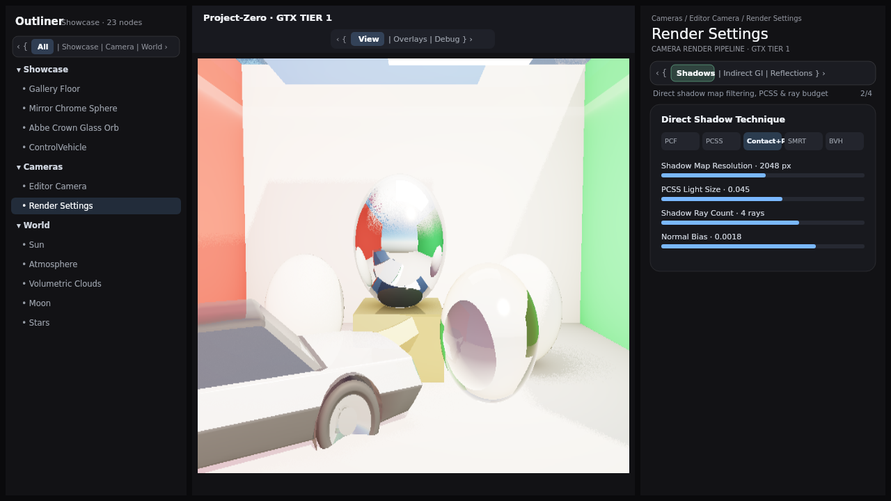

# 🧩 FrontierWorldMirror Horizontal Stage Switcher Rearrangement (HTML Only)

**Date:** 2026-11-20
**Branch:** `arena/82e06a54-frontier`
**Scope:** HTML / JSX / CSS (`Experimental/FrontierWorldMirror/`) — C++ intentionally untouched per user direction.

---

## 💡 Overview

Imported `unassignedinbox/Frontier@arena/60be9d3e-frontier` onto `arena/82e06a54-frontier`, launched `Experimental/FrontierWorldMirror` live on `:8098`, and reorganized cramped vertical inspector stacks and crowded toolbars into clean horizontal `‹ { Section A | Section B | Section C } ›` stage switchers where each stage presents only its own focused controls.

---

## ✔️ Rearranged Surfaces

| Surface | Horizontal Stage Switcher |
|---|---|
| **Outliner Domain Bar** (`Editor.jsx`) | `‹ { All \| Showcase \| Camera \| World \| Lights } ›` |
| **Viewport Toolbar** (`Editor.jsx`) | `‹ { View \| Overlays \| Debug } ›` |
| **Control Center Notch** (`Notch.jsx`) | `‹ { Quick Toggles \| Render \| Appearance \| Input \| Alerts \| Materials } ›` + `‹ { Display \| Fonts \| Theme } ›` |
| **Geometry Inspector** (`Inspectors.jsx`) | `‹ { Transform \| Material \| Surface \| Fracture } ›` |
| **Compact Material Panel** (`MaterialPanel.jsx`) | `‹ { Preset \| Channels \| Source } ›` |
| **Collection / Folder Inspector** (`FolderInspector.jsx`) | `‹ { Overview \| Contents \| Appearance } ›` |
| **Editor Camera Inspector** (`Inspectors.jsx`) | `‹ { Pose \| Lens \| Focus \| Sensor } ›` |
| **Render Settings Inspector** (`Inspectors.jsx`) | `‹ { Output \| Shadows \| Indirect GI \| Reflections } ›` |
| **Post Processing Inspector** (`Inspectors.jsx`) | `‹ { Controls \| Exposure \| Tone Mapping \| Lens Effects } ›` |
| **Sun Inspector** (`Inspectors.jsx`) | `‹ { Direction \| Radiometry \| Ephemeris \| Optics } ›` |
| **Atmosphere Inspector** (`Inspectors.jsx`) | `‹ { Sky Dome \| Scattering \| Haze & Ozone \| Optics & Bake } ›` |
| **Volumetric & Local Clouds** (`Inspectors.jsx`) | `‹ { Coverage \| Altitude \| Shadows & Wind } ›` |
| **Moon Inspector** (`Inspectors.jsx`) | `‹ { Phase & Body \| Light & Size \| Orbit & Pose } ›` |
| **Stars Inspector** (`Inspectors.jsx`) | `‹ { Star Chart \| Twinkle & Pole \| Scale & Bake } ›` |
| **Lens Flare Inspector** (`Inspectors.jsx`) | `‹ { Source \| Streaks & Ghosts \| Halo & Bake } ›` |
| **Wind Inspector** (`Inspectors.jsx`) | `‹ { Compass & Speed \| Shear & Gusts \| Telemetry } ›` |
| **Precipitation Inspector** (`Inspectors.jsx`) | `‹ { Weather Type \| Fall & Scale \| Settling } ›` |
| **Rainbow Inspector** (`Inspectors.jsx`) | `‹ { Preview \| Dispersion } ›` |
| **Height / Aerial / Local Fog** (`Inspectors.jsx`) | `‹ { Visibility \| Medium \| Wind / Shape & Wind } ›` |
| **Direct Light Inspector** (`Inspectors.jsx`) | `‹ { Transform \| Photometry \| Optics } ›` |
| **ForceField Studio** (`ForceFieldPanel.jsx`) | `‹ { Field \| Probe \| Formula \| Layers \| Cache } ›` |

---

## 🔍 Verification

- Rebuilt standalone bundle via `node Experimental/FrontierWorldMirror/Build.mjs` (`index.html`, 5.31 MiB).
- Executed `node Experimental/FrontierWorldMirror/WorldMirrorValidation.mjs` (`ALL 20 SUITES PASSED`, including Suite 20 verifying `SectionStageSwitcher` across all inspector panels, toolbars, CSS, and compiled `index.html`).
- Executed interactive `jsdom` + `@napi-rs/canvas` runtime sweep across all Outliner domains, Viewport tool stages, Control Center Notch tabs, and all 21 specialized/generic inspector panels with **0 runtime errors**.
