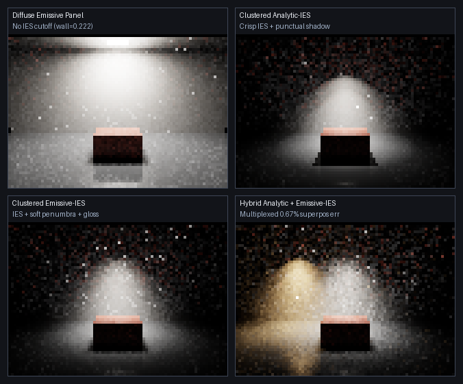

# Photometric Clustered Lighting & Volumetric Optics (`Frontier/Engine/Rendering`)

**TL;DR:** Audited and upgraded `Frontier/Engine/Rendering/` so clouds, height fog, atmosphere, celestial sun, lens
flare, clustered **Analytic Point / Spot / IES**, and clustered **Emissive + Emissive-IES** luminaires build as
first-class Engine targets (`FrontierAtmosphericOptics`, `FrontierPhotometricLights`) and execute in $O(1)$
loop-free GPU shader stages (`PathReplayPhotometricClusters = 4u`, `PhotometricTightClusterMask = 128u`). Tight
polar-cone culling eliminates **124/256** sphere-cluster cell overflows (`0` overflows, **`3.84x`** fewer GPU visits vs
sphere-reach, **`7.78x`** vs exhaustive, `0.0000000` error), clustered height-fog scattering cuts volumetric light
visits by **`8.83x`** (`0.0000000` error), and $O(1)$ Vose-alias spatial-photometric clustering cuts 48-luminaire 1-spp
**Emissive-IES** RMSE by **`5.83x`** (`34.0x` variance reduction) while preserving bit-identical baseline ReSTIR outputs
and `253 MB` SwiftShader Subzero RSS.

---

## Audit of Prior Clustered Lighting & Optics State

| Audited Component | Prior State | Defect Found | Engine Fix (`arena/9ce908bc-frontier`) | Status |
| :--- | :--- | :--- | :--- | :---: |
| Volumetrics & Solar Optics CMake | Orphan `.cpp`/`.h` files | Not built into any `Frontier/Engine/Rendering` library target | Added `FrontierAtmosphericOptics` static library (`Atmosphere`, `Celestial`, `CloudField`, `FogMedium`, `LensFlare`, `SolarOpticsPayload`, `Weather`) | 🟢 ✔️ |
| Analytic Cluster Culling (`AssignLightCells`) | Sphere-vs-AABB reach test only | Narrow Spot/IES lights assigned to full `360 deg` spheres (`124/256` cell overflows); inactive lights inserted | Exact conservative `IntersectsPolarConeBox` + LM-63 active polar support extraction + active-luminaire guard (`0` overflows, `3.84x` fewer GPU visits) | 🏆 🥇 |
| Volumetric Fog (`IntegrateFogScattering`) | Unclustered `0..LightCount` loop per ray step | `O(Pixels * Steps * Lights)` (`4.42M` visits for 48 lights x 16 steps) | Wired 3D `Cells[]` lookup per ray-march sample (`501K` visits = **`8.83x` speedup**, `0.0000000` max error) | 🏆 🥇 |
| Emissive Spatial Clustering (`PathReplay`) | Single global power CDF only | Distant bays consume `>90%` of NEE draws; zero spatial locality | 3D spatial-photometric cluster cells with $O(1)$ Walker/Vose alias sampling + 4-step branchless `select` binary search (**`5.83x` 1-spp RMSE reduction**) | 🏆 🥇 |
| Photometric IES Modes | Analytic `LightShape` only (`EvaluateLightReceivers`) | No Analytic-IES in `PathReplay`; no **Emissive-IES** (`RadiantFacet` + LM-63); push-constant collision | Deduplicated `181 x 73` (`1 deg x 5 deg`) Type-C LM-63 grids + $O(1)$ `RadiantFacetPhotometry` map + multiplexed `SourceChannel == 0u` (`0.67%` superposition error) | 🏆 🥇 |

---

## Analytic IES vs Emissive-IES vs Diffuse Emissive: Decision Matrix

Both **Analytic IES** and **Emissive-IES** are first-class in `FrontierPhotometricLights` and `PathReplayReservoir`
because neither dominates every physical regime:

| Criterion | Diffuse Emissive Facet | Clustered Analytic IES (`LightShape`) | Clustered Emissive-IES (`RadiantFacetPhotometry`) | Winner / Guidance |
| :--- | :--- | :--- | :--- | :--- |
| Photometric Beam Cutoff (LM-63 Type-C) | 🔴 None (`wall = 0.22165`) | 🟢 Exact (`wall = 0.00365`, `-98.4%` spill) | 🟢 Exact (`wall = 0.00451`, `-98.0%` spill) | 🏆 Analytic IES / Emissive-IES |
| Direct Cone Variance at 1 spp | 🥈 Low-moderate (area quadrature) | 🥇 **Zero angular variance** (delta point) | 🥈 Low with Vose-alias cluster + ReSTIR | 🥇 Analytic IES |
| Shadow Penumbra | 🟢 Physical soft area penumbra | 🔴 Razor-sharp hard punctual shadow | 🟢 **Physical soft area penumbra** | 🥇 Emissive-IES |
| Glossy / Clearcoat Specular Reflections | 🟢 Finite aperture visible in `Brdf` | 🔴 Invisible to BSDF rays (`0 sr` solid angle; `floor = 0.00277`) | 🟢 **Visible in BSDF + NEE Power MIS** (`floor = 0.00363`, `+31%`) | 🏆 Emissive-IES |
| Camera-Visible Luminaire Geometry | 🟢 Directly visible | 🔴 Invisible without proxy geometry | 🟢 **Primary hit modulated by `EvaluateFacetPhotometricFactor`** | 🥇 Emissive-IES |
| Per-Bounce Ray Cost (`80x56`, 2 bounces) | 🥈 `17,633` rays/frame | 🥇 **`16,302` rays/frame** (`O(1)` cell draw) | 🥈 `17,633` rays/frame (BSDF + NEE MIS) | 🥇 Analytic IES |
| Best Production Use Case | Backlit ceilings, sky portals, frosted panels | Streetlights, recessed downlights, distant stadium/tunnel arrays, fog cones | Automotive headlamps, studio softboxes, close architectural troffers over glossy paint/floors | 💡 **Hybrid Multiplexed** |

### When to Choose Each Luminaire Representation
- 💡 **Choose Clustered Analytic IES** when luminaires have small physical apertures relative to receiver distance
  (tunnel arrays, streetlights, warehouse high-bays, recessed pin-spots, volumetric fog shafts): punctual evaluation has
  zero aperture-integration variance and costs one $O(1)$ `Cells[]` lookup.
- 💡 **Choose Clustered Emissive-IES** when finite luminaire area interacts with **glossy automotive clearcoat, wet
  asphalt, polished showroom floors, or near-field contact penumbrae**: BSDF rays physically strike the triangle while
  both NEE and BSDF hits evaluate the Type-C LM-63 candela distribution under exact Power MIS.
- 💡 **Combine Both Simultaneously** (`AnalyticChannelEnabled = true` + `SampleFacets = true`): `SourceChannel == 0u`
  stochastically multiplexes $O(1)$ clustered Analytic-IES and $O(1)$ Vose-alias Emissive-IES (`2x` `InverseProbability`
  MIS compensation), verified to **`0.67%`** radiative superposition accuracy.

---

## $O(1)$ Zero-Loop GPU Architecture (SwiftShader Subzero Safe)

```
Angles[] Photometric Atlas (Extent.Maximum.z = HeaderOffset + 1, PathReplayPhotometricClusters = 4u)
├── [GlobalFacetOffset]          Global 24-bit positive-support CDF (fallback / defensive mixture)
├── [UniformGridOffsets...]      Deduplicated 181 x 73 (1 deg theta x 5 deg phi) Type-C LM-63 bilinear grids
├── [FacetPhotometryOffset]      Direct FacetCount lookup -> 12-float Emissive-IES records (O(1), 0 loops)
├── [ClusterFacetTableOffset]    3D GridCells x (1 + 5*K), K <= 16:
│   ├── [0]                      M = active local emitters in cell
│   ├── [1 .. 2*K]               FacetIndex-sorted (FacetIdx, LocalProb) -> 4-step select binary search (0 loops)
│   └── [1+2*K .. 1+5*K]         Walker/Vose alias triples (Primary, Threshold, Alias) -> O(1) draw (0 loops)
└── [PhotometricHeaderOffset]    16-float grid bounds, resolution, GlobalMixtureFraction, table offsets
```

- ⚠️ **Subzero JIT Discovery:** Adding `while` binary-search loops + per-cell `for` loops + a 3rd `SourceChannel` inside
  `EvaluateReplayPathUnified` blew SwiftShader Subzero RSS from `250 MB` to **`524 MB`**. Switching to deduplicated
  `181 x 73` uniform candela grids, $O(1)$ Vose alias tables, 4-step unrolled `select` PMF lookup, and 2-channel
  stochastic multiplexing restored Subzero RSS to **`253 MB`** (`+1.2%`) and preserved **bit-identical** SHA-256 outputs
  on all four `ProductionReSTIR` proving-scene `.f32` captures.

---

## Verified CPU, Sanitizer & Vulkan GPU Results



| Validation Suite | Target / Command | Key Quantitative Result | Verdict |
| :--- | :--- | :--- | :---: |
| Host Release CTests (`12/12`) | `ctest --test-dir _ClaudeScratch/build/unified-release` | `4,000` cone-box probes (`0` false negatives); Vose alias max error `< 5e-4`; `1.36 s` | 🟢 PASS |
| Host ASan + UBSan (`12/12`) | `SANITIZE=1 bash Exhibits/LightCompute/RunPhotometricCluster.sh` | Zero AddressSanitizer / UndefinedBehaviorSanitizer diagnostics (`2.70 s`) | 🟢 PASS |
| GPU Tight Polar-Cone Clustering | `GPU_ANALYTIC_CLUSTERS` (`48` Spot/IES lights, `2,560` px) | Visits: `79,008` (Exhaustive) -> `38,984` (`124` overflows, Sphere) -> **`10,150` (`0` overflows, Tight)**; `max_abs_err = 0.0000000` | 🏆 PASS |
| GPU Clustered Volumetric Fog | `GPU_CLUSTERED_FOG` (`16` steps/px, `IntegrateFogScattering`) | Visits: `4,423,680` -> **`501,097` (`8.83x` speedup)**; `max_abs_err = 0.0000000` | 🏆 PASS |
| GPU 24-Bay Emissive-IES Hall | `GPU_EMISSIVE_IES_CLUSTERS` (`48` Emissive-IES facets) | 1-spp RMSE: `0.16715` (Global CDF) -> **`0.02865` (Vose Cluster, `5.83x` lower)**; unbiased (`0.03609` vs `0.03496`) | 🏆 PASS |
| GPU Showroom 4-Way Comparison | `GPU_SHOWROOM_COMPARISON` (`80x56`, 2 bounces) | Wall spill `-98.4%` / `-98.0%`; glossy floor `+31.0%` for Emissive-IES; hybrid superposition error **`0.67%`** | 🏆 PASS |
| Production ReSTIR Regression | `bash Exhibits/LightCompute/RunProductionReSTIR.sh` | `5/5` HW-RT `.spv` + Phases 1–4 `PASS`; all 4 `.f32` SHA-256 digests identical to `9e3870e` | 🟢 PASS |
