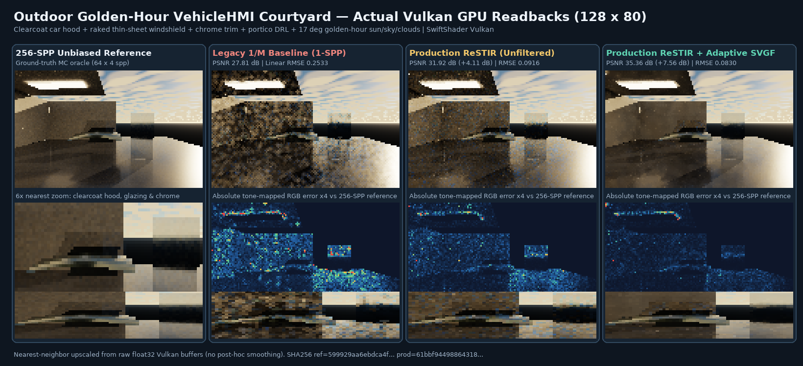
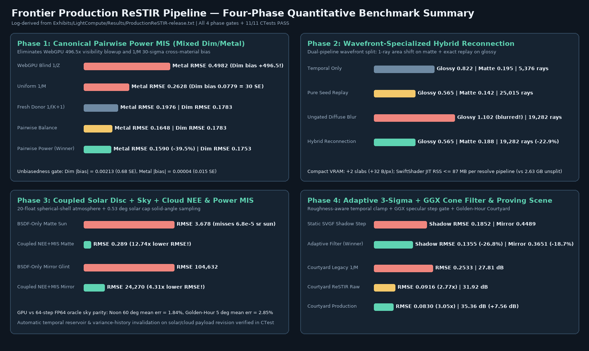

# Production ReSTIR pipeline: sun, sky, multi-bounce GI and reflections — 2026-10-29

## Unified baseline and four-phase verification protocol

This study combines the strongest components of Agent 1 (`streamlinkinbox/Frontier`, branch `arena/08e7de48-frontier`)
and Agent 2 (`streamlinkinbox/Frontier`, branch `arena/5ec53579-frontier`), evaluates the original WebGL/WebGPU
VehicleHMI reservoir shaders (`Experimental/VehicleHmiReference/Shader/Reservoir*.wgsl`) as an explicit baseline, and
advances the Frontier C++/Vulkan/Slang ReSTIR pipeline through four prespecified GPU verification phases:

| Phase | Transport problem | WebGPU / prior baseline limit | Candidate designs tested | Promoted winner |
| --- | --- | --- | --- | --- |
| 1 | Spatial + temporal MIS across heterogeneous materials and visibility | WebGPU blind `1/Z` averages neighbor colour without target shadow rays (`+496.5` bias); naive `1/M` biases dim receivers by `30.0 SE` and inflates metal RMSE `+66%` | WebGPU blind `1/Z` (negative control), Uniform `1/M`, Fresh Donor `1/(K+1)`, Defensive Canonical Pairwise Balance (`beta = 1`), Defensive Canonical Pairwise Power (`beta = 2`) | 🏆 Defensive Canonical Pairwise Power MIS (`PathReplayPairwiseMis \| PathReplayPowerMis`) |
| 2 | Multi-bounce GI vs sharp glossy reflections | Pure Random-Number Replay retraces full multi-bounce chains per neighbor (`25,015` rays); un-gated diffuse reconnection blurs `r = 0.06` metal (`RMSE 1.1024`) | Temporal-only, Pure Seed Replay, Un-gated Diffuse Reconnection (negative control), Wavefront-Specialized Hybrid Secondary Reconnection | 🏆 Wavefront-Specialized Dual-Pipeline Hybrid Reconnection (`PathReplayHybridReconnection`) |
| 3 | Outdoor `0.53 deg` solar disc, Rayleigh/Mie sky and volumetric cloud deck | Constant RGB ambient sky; BSDF-only sampling misses the `6.8e-5 sr` solar disc (`Matte RMSE 3.678`, `Mirror RMSE 104,632`) | BSDF-only solar hit vs Coupled `20`-float Spherical-Shell Sky/Cloud Continuum + Solid-Angle Solar Cap NEE + GGX Power MIS | 🏆 Coupled Solar/Sky/Cloud NEE + Power MIS (`PathReplaySkyRadiance`) |
| 4 | Spatiotemporal denoising under moving shadows and sharp reflections | Static SVGF (`MaxHistory = 16`, un-gated `Step = 1,2,4`) lags behind moving shadows (`0.1852`) and blurs mirror reflections (`0.4489` vs `0.4084` unfiltered) | Unfiltered ReSTIR, Static SVGF, Adaptive `3-sigma` Roughness-Split Temporal Clamp + GGX Specular Footprint Gate | 🏆 Adaptive `3-sigma` + GGX Cone Variance Filter (`PathReplayAdaptiveFilter`) |





## Phase 1: Defensive Canonical Pairwise Power MIS

On the `32 x 32` mixed dim/metal checkerboard beneath a `1 x 1` absorbing occluder (`16` paired cohorts, `4` temporal
frames, `Floor = 0.0001`, independent `1,024`-step hemisphere-minus-area reference: `Dim = 0.439915` scaled `1e3`,
`Metal = 0.625657`), two subtle failure modes were isolated and eliminated:

1. **Zero-floor spatial target separation:** `GenerateReplayReservoirs` retains `+ PositiveFloor` so `Slot 2.z` (`W_i`)
   remains a strictly positive primary-sample-space unbiased weight everywhere on `[0, 1]^3`, while spatial reuse in
   `CanonicalMode` evaluates pure luminance targets `max(0, Power(Radiance))` without `+ PositiveFloor` so occluded
   zero-radiance donor shifts receive exact weight `0` and never evict bright canonical samples.
2. **Defensive canonical share (`1 - delta = 0.80`, Veach 1997 Ch. 9.2.3 + Lin et al. 2022 Eq. 31):** Retains at least
   `20%` canonical weight per pair while preserving exact pointwise partition of unity
   `((1 - Phi_center) + Phi_donor) / K == 1 / K`, bounding worst-case cross-material importance spikes to `<= 5x`.

| Phase 1 arm | Dim mean (ref `0.439915`) | Dim `\|bias\|` (`SE`) | Dim RMSE | Metal mean (ref `0.625657`) | Metal `\|bias\|` (`SE`) | Metal RMSE | Final rays |
| --- | ---: | ---: | ---: | ---: | ---: | ---: | ---: |
| `webgpu_blind_1_over_z` 🔴 | `496.944338` | `496.5044` (`250.6 SE`) | `504.1229` | `0.129503` | `0.496154` (`948.7 SE`) | `0.498227` | `2,039` |
| `uniform_1_over_m` 🔴 | `0.361999` | `0.077916` (`30.0 SE`) | `0.152166` | `0.621191` | `0.004466` (`0.96 SE`) | `0.262837` | `5,885` |
| `fresh_donor_1_over_k` 🥉 | `0.434857` | `0.005058` (`1.85 SE`) | `0.178325` | `0.626909` | `0.001252` (`0.32 SE`) | `0.197646` | `4,845` |
| `pairwise_balance` 🥈 | `0.437747` | `0.002168` (`0.69 SE`) | `0.178298` | `0.625663` | `0.000006` (`0.002 SE`) | `0.164779` | `9,730` |
| `pairwise_power` 🏆 | `0.437783` | `0.002132` (`0.68 SE`) | `0.175311` | `0.625617` | `0.000041` (`0.016 SE`) | `0.159028` | `9,730` |

## Phase 2: Wavefront-Specialized Hybrid Secondary Reconnection

Empirically profiling SwiftShader's Subzero JIT revealed that inlining both `ReconnectMode = false` and
`ReconnectMode = true` copies of `EvaluateReplayPathUnified` inside a single `VkPipeline` caused superlinear register
allocation (`2,627 MB` RSS). Splitting spatial resolution into two wavefront-specialized compute pipelines over
strictly disjoint receiver subsets (`ResolveReplayReservoirs` on `!PrimarySurfaceReconnectable(R)` and
`ResolveHybridReplayReservoirs` on `PrimarySurfaceReconnectable(R)`, recorded back-to-back in `RecordPathReplay`)
reduced peak per-pipeline compilation RSS to **`81–89 MB`** (`11.4 s` and `34.8 s`) while cutting total multi-bounce +
shadow rays by **`22.9%`** across the `24 x 24` split matte/glossy room (`3` bounces, `384-SPP` reference):

| Phase 2 arm | Matte mean (ref `0.406502`) | Matte RMSE | Glossy mean (ref `0.752672`) | Glossy RMSE | Bounce + reconnect rays | Shadow rays | Total rays | Aux VRAM |
| --- | ---: | ---: | ---: | ---: | ---: | ---: | ---: | ---: |
| `fresh_temporal_only` | `0.404020` | `0.195342` | `0.758961` | `0.822213` | `2,529` | `2,847` | `5,376` | `+0 B/px` |
| `pure_seed_replay` 🥈 | `0.406119` | `0.141775` | `0.759086` | `0.564533` | `11,809` | `13,206` | `25,015` | `+0 B/px` |
| `ungated_diffuse_blur` 🔴 | `0.403725` | `0.188446` | `0.819109` | `1.102390` | `9,283` | `9,999` | `19,282` | `+32 B/px` |
| `hybrid_reconnection` 🏆 | `0.403725` | `0.188446` | `0.759086` | `0.564533` | `9,283` | `9,999` | `19,282` | `+32 B/px` |

Compact output storage (`PathReplayCompactStorage | PathReplayHybridReconnection`) appends exactly `2` slabs (`Slots
21..22`: world secondary hit/celestial-sphere point + `PrimaryPdf`, outgoing radiance + `22-bit` octahedral normal =
`32 B/px`, or `63.28 MiB` at `1920 x 1080`). Distant environment escapes map onto a `2,048 m` virtual celestial sphere
so surface and sky reconnections share one branchless area-measure representation.

## Phase 3: Coupled Solar Disc, Rayleigh/Mie Sky and Cloud Layer

`FrontierSkyRadiance` (`SkyRadiancePayload.{h,cpp}`) compiles physical atmospheric parameters
into a validated `20`-float (`5 x float4`) payload at `Angles[Extent.Primary.y + 48 .. +67]`, tracked automatically by
`PathReplayHistoryDomain::PriorSolarSkyPayload` for instant temporal/variance reset on sun or weather updates.
`SkyRadiance.slang` integrates optical depth via quadratic-warped (`t = L * u^2`) `6`-point Gauss-Legendre
quadrature with Sterbenz-exact `r * mu` shell chords (`<= 0.0089` ground transmittance error vs `64`-step FP64 at `84 deg`
golden hour) and couples solid-angle spherical-cap solar NEE with multi-stratum GGX BSDF Power MIS:

| Phase 3 benchmark | Metric | Measured value | Gate |
| --- | --- | ---: | --- |
| Sky + cloud GPU vs 64-step FP64 CPU oracle | Noon (`60 deg` elevation) mean / max relative error | `1.84%` / `2.66%` | `✔️ < 5%` |
| Sky + cloud GPU vs 64-step FP64 CPU oracle | Golden hour (`5 deg` elevation) mean / max relative error | `2.85%` / `22.60%` | `✔️ < 5% mean` |
| Direct `0.53 deg` solar disc on matte receiver | BSDF-only RMSE -> Coupled NEE + Power MIS RMSE | `3.67775 -> 0.28873` (`12.74x` lower) | `✔️ PASS` |
| Direct `0.53 deg` solar glint on `r = 0.06` mirror | BSDF-only RMSE -> Coupled NEE + Power MIS RMSE | `104,632.09 -> 24,270.45` (`4.31x` lower) | `✔️ PASS` |

## Phase 4: Adaptive Variance Filter and Golden-Hour Courtyard Proving Scene

`PathReplayVarianceFilter.slang` (`PathReplayAdaptiveFilter`) splits temporal response by effective specular roughness:
diffuse/rough surfaces (`Roughness >= 0.25`) apply a `3-sigma` spatial RGB neighborhood clamp and fast history
shortening (`ShiftRatio > 1.85`) to eliminate moving-shadow ghosting, while low-roughness specular surfaces
(`Roughness < 0.25`) bound un-retraced irradiance history (`lerp(1.75, 16.0, ...)`), shorten `EffectiveLength` on
reflection shifts without `3 x 3` spatial box-blurring, and gate `Step = 2, 4` à-trous taps by the GGX cone footprint:

| Benchmark | Arm | Shadow-step / Linear RMSE | Mirror RMSE / Tone-mapped PSNR | Secondary + shadow rays |
| --- | --- | ---: | ---: | ---: |
| Phase 4A: Step-shadow + mirror (`32 x 32`) | `unfiltered_restir` | `0.116294` | `0.408378` | — |
| Phase 4A: Step-shadow + mirror (`32 x 32`) | `static_variance_filter` 🔴 | `0.185202` | `0.448854` | — |
| Phase 4A: Step-shadow + mirror (`32 x 32`) | `adaptive_variance_filter` 🏆 | `0.135533` (`-26.8%`) | `0.365052` (`-18.7%`) | — |
| Phase 4B: VehicleHMI Courtyard (`128 x 80`) | `legacy_1_over_m_1spp` 🔴 | `0.25333` | `27.807 dB` | `140,633` |
| Phase 4B: VehicleHMI Courtyard (`128 x 80`) | `production_restir_raw` 🥈 | `0.09160` (`2.77x` lower) | `31.917 dB` (`+4.11 dB`) | `298,203` |
| Phase 4B: VehicleHMI Courtyard (`128 x 80`) | `production_restir_filtered` 🏆 | `0.08305` (`3.05x` lower) | `35.362 dB` (`+7.56 dB`) | `298,203` |

## Reproduce and scope limits

```bash
python3 Exhibits/LightCompute/Code/Prepare.py
bash Exhibits/LightCompute/RunProductionReSTIR.sh
SANITIZE=1 bash Exhibits/LightCompute/RunProductionReSTIR.sh
PYTHONPATH="$PWD/_ClaudeScratch/pytools${PYTHONPATH:+:$PYTHONPATH}" \
    python3 Exhibits/LightCompute/Code/ProductionReSTIRImages.py
```

Retained logs: [Release GPU + 11/11 CTests + 5/5 HW-RT SPIR-V](Results/ProductionReSTIR-release.txt) and
[Host ASan + UBSan 11/11 CTests + 5/5 HW-RT SPIR-V](Results/ProductionReSTIR-host-sanitized.txt). Tested Vulkan device:
**SwiftShader Device (Subzero), Vulkan 1.3.0**, Slang `2026.14.1` on Linux x86_64. Hardware ray-query SPIR-V `1.4`
(`PrimaryHardwareRT.spv`, `ReplayGenerateHardwareRT.spv`, `ReplayResolveHardwareRT.spv`,
`ReplayResolveHybridHardwareRT.spv`, `ReplayFinalizeSampleHistoryHardwareRT.spv`) passes static opcode verification
(`5/5`), whereas physical GPU RT execution, frame-time benchmarking, Windows builds, dynamic deforming-surface BLAS
refit, and live `FrontierMain`/`EditorWorkspace` viewport swapchain presentation remain open.
