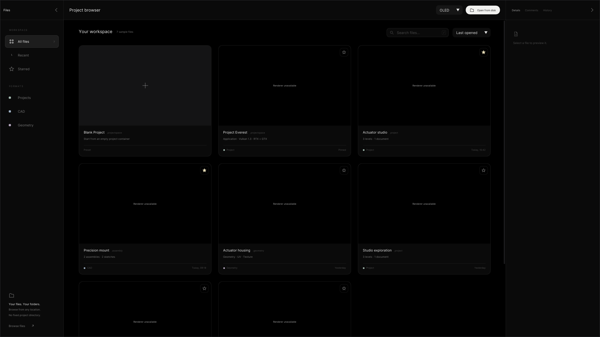
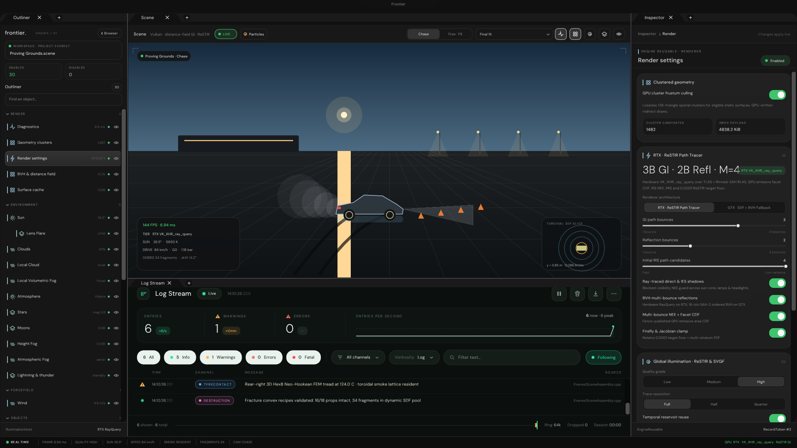
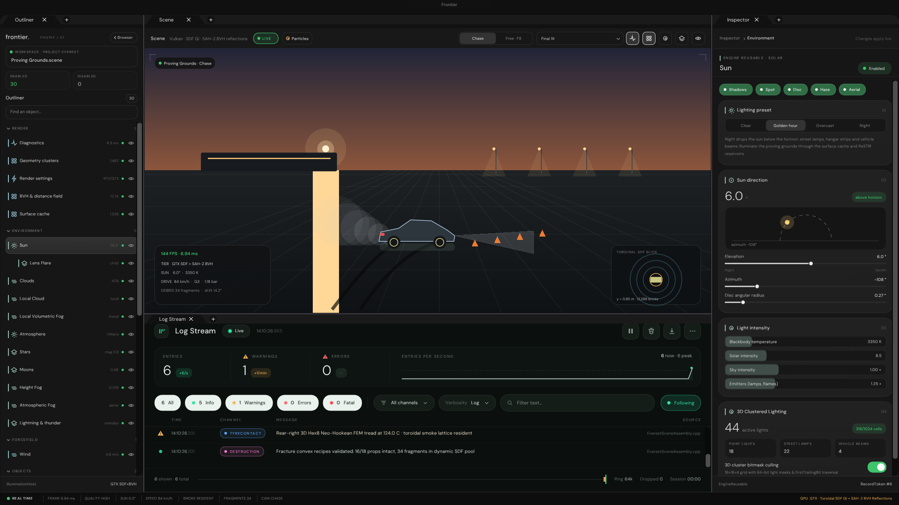
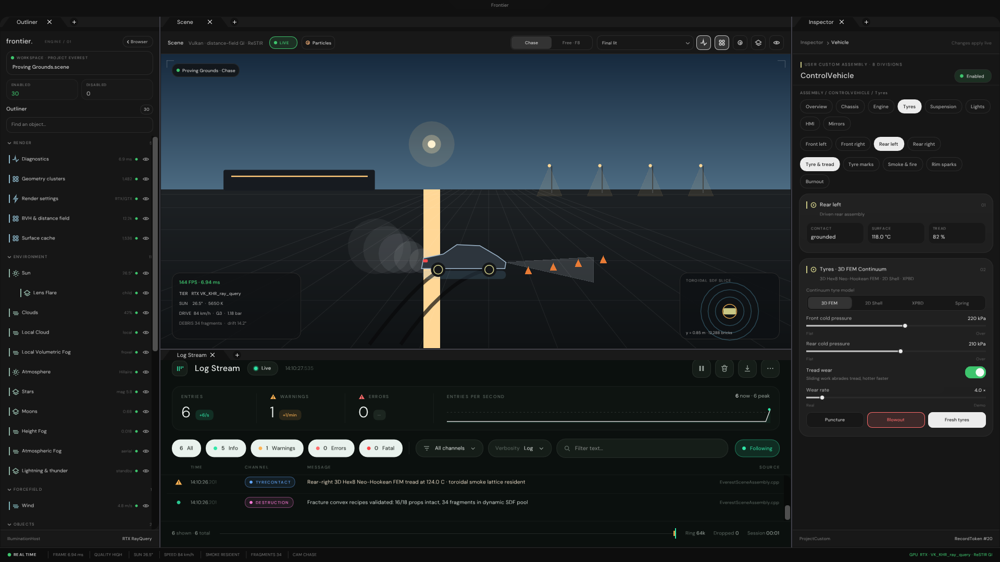
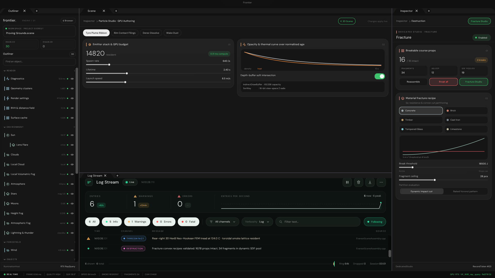
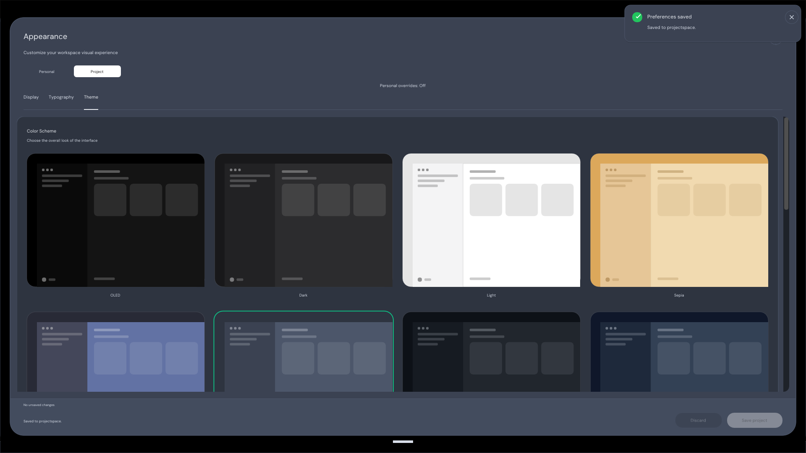
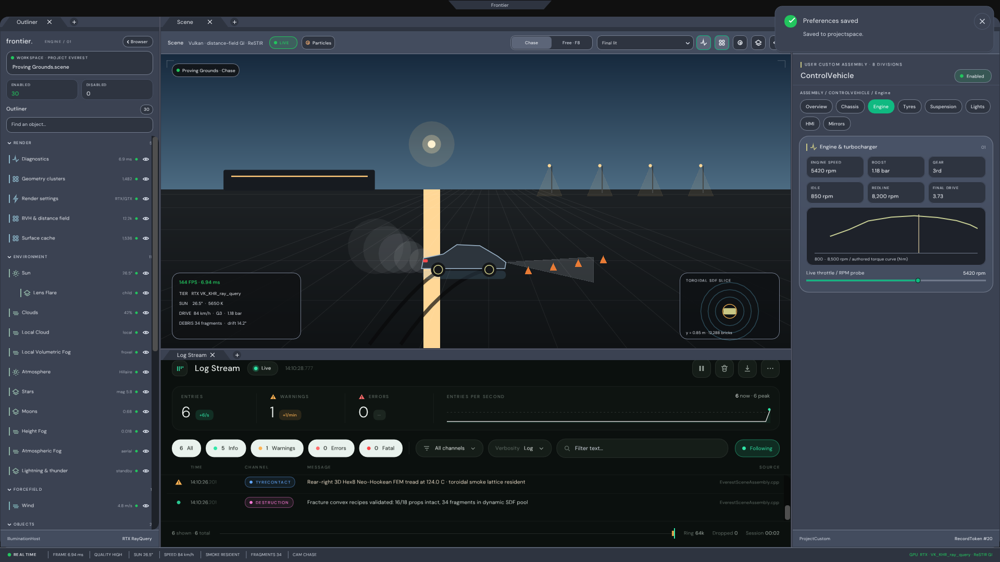

# Project Everest — 1:1 VehicleHMI UI & Modular Inspector Exhibits

All captures below are authentic `1920x1080` headless ImGui CPU rasterizations produced by `ProjectEverestValidation` (`Exhibits/ProjectEverest/Code/ProjectEverestValidation.cpp`).

---

## 01 — Project Browser Discovering Project Everest
`Captures/01_ProjectBrowser_SelectEverest.png`

---

## 02 — Project Everest Workspace (RTX · `VK_KHR_ray_query` ReSTIR GI + Docked LogStream)
`Captures/02_Everest_RenderSettings_RTX_vs_GTX.png`

---

## 03 — GTX Fallback (Toroidal SDF GI + SAH-2 BVH Reflections) & Reusable Built-In Sun Inspector
`Captures/03_Everest_GTX_Fallback_And_SunInspector.png`

---

## 04 — User-Authored Custom Vehicle Inspector (`ControlVehicle` -> Tyres -> Rear Left -> 3D Hex8 FEM)
`Captures/04_Everest_ControlVehicle_CustomInspector.png`

---

## 05 — Dedicated Domain Studios (`Particle Studio` Workbench + `Fracture` Recipe Inspector)
`Captures/05_Everest_DedicatedStudios_FractureAndParticles.png`

---

## 06 — `ControlCentrePanel` Theme Drawer Expanded (Applying Nord + Emerald to Project Everest)
`Captures/06_Everest_ControlCentre_ThemeDrawer.png`

---

## 07 — Live Nord + Emerald Theme Applied Across Project Everest Workspace & Engine Torque Curve
`Captures/07_Everest_NordTheme_AppliedToWorkspace.png`

