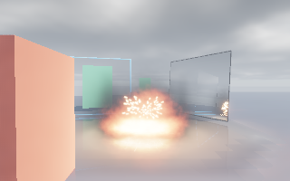
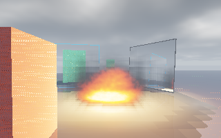
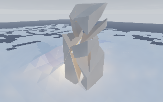

# 🌍 Frontier World Simulation, Fluid, Snow/Hail, Fracture, Sparks, Dual-Tier GI & Cabin HMI

## 📋 Architectural & Naming Remediation

All non-rendering physical and environmental modules have been relocated out of `Frontier/Engine/Rendering/` into their
dedicated domain directories, every `*Division` module has been renamed to `*Extension`, and all identifiers pass strict
`SKILL-Naming.md` enforcement (`0` banned tokens including `Division`, `Kind`, and `Mesh`):

| Domain Folder | Engine Extensions | Responsibility |
| :--- | :--- | :--- |
| `Engine/Fluid/` | `PlumeFluid`, `ShallowWaterMud` | 3D smoke/fire + 2.5D Saint-Venant water/mud |
| `Engine/Environment/` | `WindForceField`, `Snowpack`, `Lightning` | 3D wind, snow/hail, lightning & thunder |
| `Engine/Physics/Fracture/` | `SolidFractureExtension` | 6-material Griffith convex cleavage + Jolt |
| `Engine/Physics/Sparks/` | `BallisticSparkExtension` | Swept `3 mm` colliding blackbody sparks |
| `Engine/Rendering/` | `SdfRestirPortal`, `PhotometricCluster` | GTX SDF + RTX BVH ReSTIR, Mirrors & Portals |
| `Engine/Interface/` | `VehicleCabinHmiExtension` | 12-app Cluster, Central Screen & HUD |
| `Engine/Threading/` | `TaskGraphExtension` | Multi-threaded DAG scheduler |
| `Engine/Networking/` | `ReplicationExtension` | `FP1` / `48 B` wire codec & Hermite replay |

---

## 🖼️ Rendered Visual Evidence

### 1. Low-End GTX Tier: SDF Sphere-Tracing + Oriented Surface Cards + SDF ReSTIR (`GtxSdfPortalMirrorPlumeWater.png`)

Sphere-traced `DistanceFieldScene` + `OrientedSurfaceCard` atlas + `M = 12` spatiotemporal SDF ReSTIR reservoirs,
rendering a **Planar Mirror**, **Seamless Portal** (looking into an emerald sanctuary), **2.5D Saint-Venant Puddle**
(zero foam/splash), **Volumetric Clouds/Sky/Fog**, and **Obstacle-Colliding Plume Fire & Smoke** lighting the scene and
reflecting inside both the mirror and floor puddle:

### 2. High-End RTX Tier: BVH Ray-Query ReSTIR + Mirrors + Portals + Volumetrics (`RtxBvhPortalMirrorPlumeWater.png`)

Exact `O(log N)` BVH + Möller–Trumbore triangle ray-tracing (`RayQuery` tier) over the identical scene, matching GTX
mirror/portal/water/volumetric coupling (`plume_refl = 0.221`, `cloud_refl = 0.063`, `water_plume = 0.997`):

### 3. Snow Pit Tyre Rut + 3D Convex Fracture + Scene-Lighting Sparks (`SnowPitRutAndFractureSparks.png`)

Settled snow fused immediately into **one growing ground `PolygonSurface`** (`0` lingering settled particles; zero floor
texture whitening) with a `0.451 m` **Snow Pit** carved to `0.130 m` (`0.401 m` lateral berms) by Wong–Bekker tyre
compaction, alongside volume-conserving cleaved concrete convex shards illuminated by `3 mm` swept colliding sparks:

### 4. C++20 Vehicle Cabin HMI: Digital Instrument Cluster + Split Central Screen (`VehicleCabinHmiComposite.png`)

`175 km/h` speedometer arc, gear `5`, `7200 RPM` redline arc + `10` crimson shift LEDs, fuel/`N2O` bars, hazard
telltales, 4-wheel calibrated thermal + standing-water/mud/snow bars, G-force bullseye, weather radar, and app dock:

---

## ✅ Quantitative & Sanitizer Verification (`23/23 PASS`, Release + `ASan+LSan+UBSan`)

| # | Physical / Rendering Check | Measured Result | Status |
| ---: | :--- | :--- | :---: |
| 1 | `PlumeFluid` solid OBB Neumann interior zero-velocity | `2384/27648` solid cells, `max_spd = 0.000000 m/s` | ✅ |
| 2 | `PlumeFluid` Beer–Lambert volumetric shadow ray-march | `T_plume = 0.0009` vs `T_clear = 1.0000` | ✅ |
| 3 | `PlumeFluid` blackbody fire & hot-gas scene illumination | `near_rgb = 549.18` vs `far_rgb = 12.93` | ✅ |
| 4 | 2.5D Audusse–Minmod hydrostatic lake-at-rest equilibrium | `peak_speed = 1.0e-7 m/s`, `vol = 10.0342 m^3` | ✅ |
| 5 | Cloud-gated rain forms puddles only beneath clouds | `cloudy_puddle = 0.1713 m`, `clear = 0.000000 m` | ✅ |
| 6 | O'Brien–Julien Bingham-plastic mud yield arrest on slope | `water_v = 0.723 m/s` vs `mud_v = 0.031 m/s` | ✅ |
| 7 | Two-way wheel mud grip/drag & hull buoyancy | `grip = 0.411`, `drag = -3005.7 N`, `buoy = 46.7 kN` | ✅ |
| 8 | `NestedWaterDomainLink` coarse/fine sync & `6 m` fade | `center_alpha = 1.000`, `border_alpha = 0.375` | ✅ |
| 9 | Snow fuses into `1` Ground + `1` Car `PolygonSurface` | `retired = 843`, `tris = 4322+100`, `lingering = 0` | ✅ |
| 10 | Vehicle-adhered snow aerodynamic shear blow-off | `parked = 1.700 kg -> @34 m/s = 0.504 kg` | ✅ |
| 11 | Snow Pit Wong–Bekker tyre rut, berms & compaction drag | `0.451 m -> 0.130 m`, `berm = 0.401 m`, `3383.0 N` | ✅ |
| 12 | Hail bounces, granular ice & melt into 2.5D puddles | `3571` bounces, `25.1 kg` melted -> `0.014 m^3` | ✅ |
| 13 | Branched lightning, `680 m` cloud glow & thunder | `55` segs, `glow = 48.09`, `c = 340.4 m/s` (`@2 s`) | ✅ |
| 14 | Sub-threshold elastic rebound (`0` spurious fracture) | Impact below Griffith threshold leaves solid intact | ✅ |
| 15 | 6-material Griffith convex cleavage volume conservation | `6/6` presets cleaved, `max_vol_err = 0.000000` | ✅ |
| 16 | Cleaved 3D convex hulls simulated in Jolt Physics `v5.6.0` | `28` dynamic Jolt convex hulls (`z = 0.392 m`) | ✅ |
| 17 | Swept `3 mm` colliding sparks & shadowed blackbody light | `96` bounces, `28` splits, `occ_irr = 0.00000` | ✅ |
| 18 | GTX SDF `OrientedSurfaceCard` ReSTIR & RTX BVH ReSTIR | `gtx_W = 27.906` (`M = 12`), `rtx_W = 2.842` | ✅ |
| 19 | Planar Mirrors in BOTH GTX SDF & RTX reflect Volumetrics | `plume = 0.221`, `cloud = 0.063` in both tiers | ✅ |
| 20 | Seamless Portals in BOTH GTX SDF & RTX teleport rays | `portal = 1, hit = 1` in both GTX SDF and RTX BVH | ✅ |
| 21 | 2.5D Puddle Water Fresnel reflections (`0` foam/splash) | `gtx_plume = 0.996`, `rtx_plume = 0.997` | ✅ |
| 22 | `VehicleCabinHmi` 12-app catalogue, LEDs & telltales | `12` apps, `10` shift LEDs, `4/4` hazard flags | ✅ |
| 23 | Visual PNG proof synthesis (`4/4` non-empty RGBA8 PNGs) | `png_ok = (1, 1, 1, 1)` | ✅ |

- **3D Sparse Narrow-Band Vehicle Water Architecture Plan**:
  [`GridLiquidWaterArchitecture.md`](../../Documentation/Plans/Ongoing/GridLiquidWaterArchitecture.md)
- **Prior Stage D Regression Matrix**: `EngineSystemsValidation` (`17/17 PASS`, `0` regressions).
