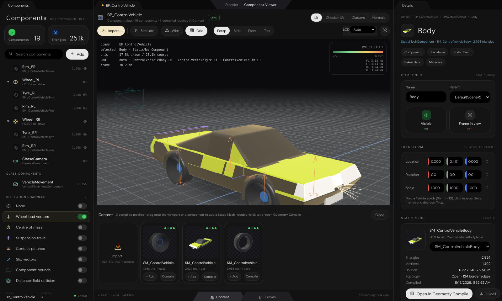
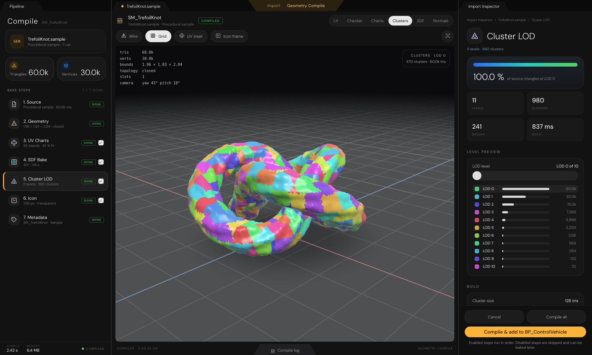
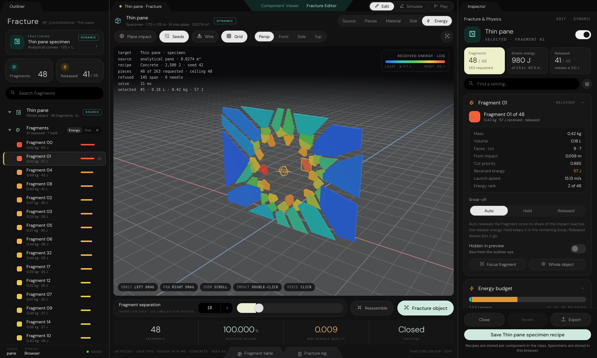
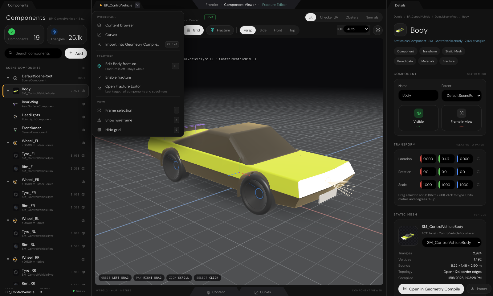
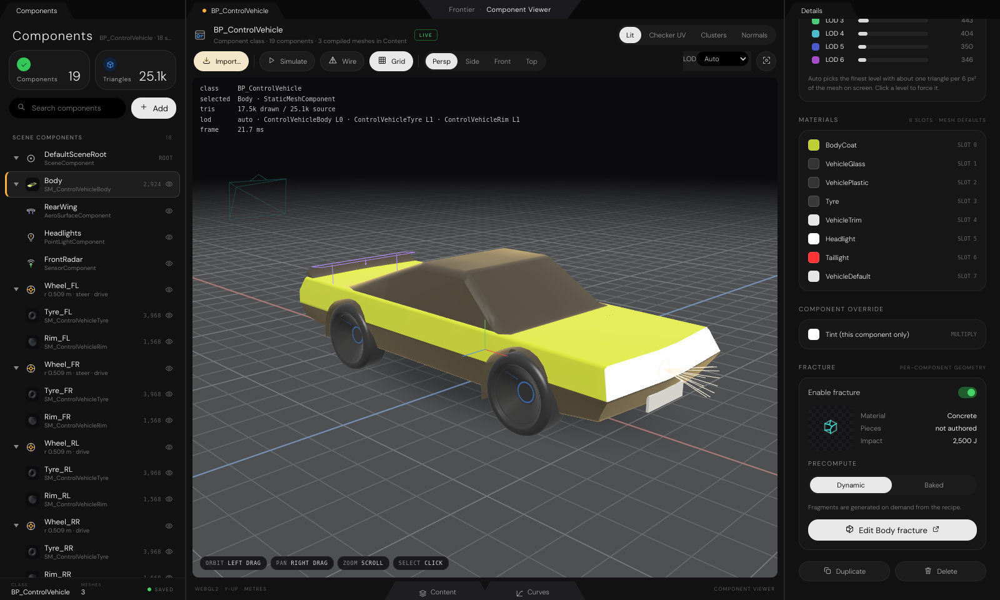
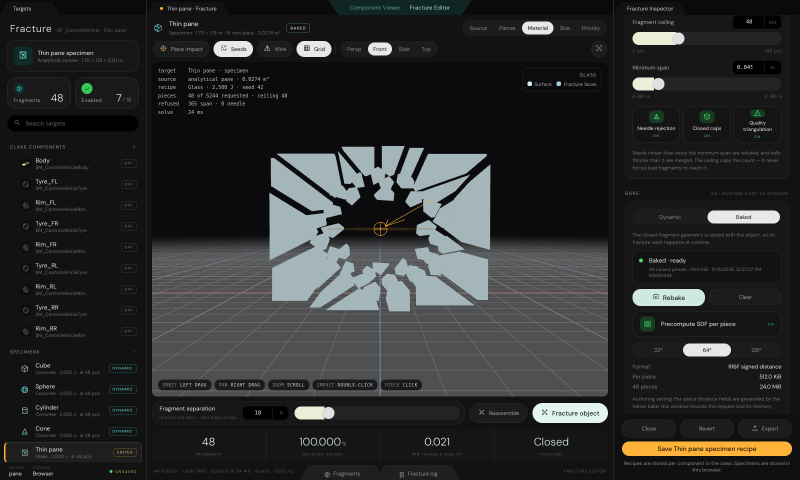

# Component Studio

One HTML demo with three workspaces in the Project Zero UI (the visual language of the Frontier-1 Cluster LOD Studio, branch `arena/453e172d-frontier-1`):

| Workspace | What it is | Came from |
|---|---|---|
| **Component Viewer** | A Blueprint-class style editor and previewer for a component class, here `BP_ControlVehicle` | **Vehicle Lab** (Frontier-OLD, `Experimental Remastered/AssetInspector`), renamed and rebuilt |
| **Geometry Compile** | The import inspector. Any imported object opens here first and goes through Source → Geometry → UV Charts → SDF Bake → Cluster LOD → Icon → Metadata | Frontier-1 Cluster LOD Studio "Hero Workspace" (geometry editor, UV charts, SDF baker, icon capture, cluster LOD) |
| **Fracture Editor** | Per-component fracture authoring: material, impact, quality limits, Dynamic / Baked + piece SDF, fragment inspection | Frontier-OLD `arena/bc062d35-frontier-old` Project Zero Fracture card + the Fracture panel / Fracture Studio branches, redesigned |





## Run

```
python3 Serve.py          # http://localhost:8090/
```

Pure ES modules with a raw WebGL2 renderer. There is no build step and nothing is vendored. Serve the folder over HTTP: modules and workers do not load from `file://`.

URL helpers: `?sample=vase|braid|torus|knot|asteroid|planet|terrain` opens Geometry Compile on a procedural sample. `?drawer` opens the Content drawer.

## Component Viewer (formerly Vehicle Lab)

- **Components dock**: a search box and the scene component tree.
  - Rows show icons, or the compiled mesh thumbnail for Static Mesh components. Each row has a visibility eye and a triangle count.
  - Drag a row onto another row to re-parent it (the world transform is kept). Drag a Content card onto a row to add a mesh under it.
  - Below the tree: **Class components** (`VehicleMovement`) and the **Inspection channels** carried over from Vehicle Lab: wheel load, centre of mass, suspension travel, contact patches, slip vectors, component bounds and distance-field collision.
- **Viewport**:
  - View modes: Lit, Checker UV, Clusters and Normals.
  - Camera presets: Persp, Side, Front and Top. Wire and Grid toggles.
  - **LOD**: Auto picks a level per mesh from its screen size (about one triangle per 6 px²). You can also force LOD 0–4 or the coarsest level.
  - Click to select. Gizmos are drawn for cameras, lights, sensors, ballast, aero surfaces and wheels.
  - **Simulate** runs a longitudinal drive preview. It uses the torque curve × turbo multiplier × gearing against drag, rolling resistance and brakes. Wheels spin and steer, and the floor scrolls.
- **Details** changes with the type of the selected component:
  - Component: name and parent. Transform: scrub fields.
  - Static Mesh: mesh picker, baked-data chips, the cluster LOD level list (click a level to force it), material slots and a per-component tint.
  - Wheel, Camera, Light, Sensor, Ballast and Aero Surface each get their own controls.
  - Vehicle Movement holds every Vehicle Lab tuning value, seeded from the Vehicle HMI ControlVehicle sheets.
  - The root shows a class summary with bake coverage, Reset and Export JSON.
- **Content drawer**: the compiled meshes, each with UV / SDF / LOD / icon dots.
  - Drag a card into the viewport, or click **+ Add**.
  - Double-click a card to re-open it in Geometry Compile.
- **Curves drawer**: editable Torque and Turbo curves with linear, smooth or step interpolation.
  - Double-click adds a point, right-click removes one.
  - The redline is marked, and the live rpm is shown while simulating.
- **Add component** dialog: Static Mesh, Wheel, Camera, Light, Sensor, Ballast or Aero Surface. Choose the parent and a mount point (roof, nose, tail, left, right).
- Keys: `F` frame, `G` grid, `Z` wire, `Space` simulate, `Del` delete, `Ctrl+D` duplicate, `Ctrl+I` import.
- Storage:
  - The class is saved in `localStorage` (`frontier.componentStudio.class.v1`).
  - Compiled imports are saved in IndexedDB (`frontier-component-studio`).
  - The three ControlVehicle meshes are rebuilt from the FCT1 facet streams on every load.

## Geometry Compile (import inspector)

There are three ways to open it: **Import…** (OBJ / STL / FCT1, or a procedural sample), dropping a file anywhere, or **Open in Geometry Compile** on an existing mesh.

| Step | Bakes | Inspector |
|---|---|---|
| 1 Source | read, weld, drop degenerates | units (keep / fit 1 m / fit 2 m), import scale, up axis, material slots |
| 2 Geometry | transform + normals | scale (uniform lock), mirror, rotate, centre, flip, smoothing angle |
| 3 UV Charts | planar island unwrap + pack | island normal limit, merge thresholds, UV sheet preview, OBJ / SVG export |
| 4 SDF Bake | signed distance field (worker) | resolution 32³–80³, narrow band, slice preview, iso surface |
| 5 Cluster LOD | Nanite-style cluster DAG (worker) | cluster size, group size, keep ratio, **Preserve materials**, level slider, cluster / material colours, seam overlay, materials-per-level table |
| 6 Icon | thumbnail capture | ¾ / front / side / top, yaw, pitch, size, background, live icon frame |
| 7 Metadata | `SM_*` name, category, tags, notes | compile summary |

- UV, SDF, Cluster LOD and Icon are optional; each has its own include checkbox.
- Changing a step marks the steps after it stale.
- Under 150k triangles, UV and Icon re-run automatically.
- **Compile & add to BP_ControlVehicle** saves the mesh to Content and adds a Static Mesh component.
- When re-opened from an existing mesh, the button becomes **Compile & update**. The update applies everywhere the mesh is used.
- Keys: `1`–`7` steps, `F` frame, `Esc` close.

## Material-preserving Cluster LOD

Every triangle keeps its material through every LOD level. The simplifier only moves a vertex onto an existing vertex and never creates triangles, so nothing has to be re-guessed afterwards. The Component Viewer draws LOD levels with these real materials.

**Preserve materials** (on by default for meshes with 2+ material slots) makes each material reduce like a separate mesh **without splitting it**:

- Clusters are single-material.
- An edge whose two triangles carry different materials is a seam. A vertex on a simple two-material seam may only slide along that seam onto another seam vertex.
- Seam corners (turns over ~50°), junctions where 3+ materials meet, and seam/border meetings never move. Seams get constraint planes like open borders.
- A seam loop can't shrink below three edges, so small islands (lights, glass, trim) never vanish.
- Neighbouring clusters and materials keep sharing the same seam vertices and edges. There is one vertex buffer, no duplicated seams and no cracks.
- The build stops once there is one cluster per material, instead of shrinking the surface further.

`node Tests/MaterialLodCheck.mjs ControlVehicleBody.facet` prints, per level, seam vertices off the source seams, material share drift, lost materials, area and non-manifold edges, with the toggle off vs on. On the body at LOD 4:

| | Off | On |
|---|---|---|
| Materials still present | 4 / 8 (glass, trim, headlights and taillights gone) | 8 / 8 |
| Seam vertices off the source seams | 4 / 116 | 0 / 196 |
| Surface area kept | 78 % | 84 % |
| New non-manifold edges | 0 | 0 |

The rim's hub material is gone by LOD 3 with the toggle off. With it on, the hub survives every level.

## Fracture Editor

A UI redesign, not a renderer. The viewport shows the recipe's result with flat colours. Its job is to make the recipe readable.

**How to open it.** As in the Project Zero Editor, the Component Viewer has several ways in:

| Where | What |
|---|---|
| **Details → Fracture card** | Project Zero's compact per-object card. It has an Enable switch, a Dynamic / Baked choice, a thumbnail and recipe summary, and an **Edit {Component} fracture ↗** button. |
| **Workspace tab menu** (the ▾ on the `BP_ControlVehicle` tab, or right-click the tab strip) | Has a FRACTURE section: **Edit {selected} fracture…**, Enable / Disable fracture, **Open Fracture Editor**. Also lists Content, Curves, Import and the View toggles. |
| **Outliner right-click** | Per-component menu: Frame, Open in Geometry Compile, Edit fracture, Enable / Disable fracture, Hide, Duplicate, Delete. Non-mesh components say "Fracture needs a mesh". |
| **Outliner pill** | Mesh rows with fracture on show `DYN` / `BAKED` / `UNBAKED`. Click the pill to open that component. |
| **Toolbar** | The teal **Fracture** tool opens the selected mesh. With no mesh selected it opens the last target. |
| **Notch** | Click `Frontier · Component Viewer · Fracture Editor` to switch to the Fracture Editor. Click `Component Viewer` there to come back. |
| **Keys / URL** | `Shift+F` opens the editor. `?fracture=body` opens a class component, `?fracture=specimen:pane` opens a test specimen. |






| Area | Contents |
|---|---|
| **Targets** (left) | Owner card, fragment and enabled stats, search. Class mesh components carry Off / Dynamic / Baked / Stale / Edited pills. There are seven analytical specimens (cube, sphere, cylinder, cone, thin pane, beam, rock) and four presets (Shatter, Crumble, Splinter, Dice). |
| **Well** (centre) | Views: Source / Pieces / Material / Size / Priority. Tools: place impact, seeds, wire, grid. Cameras: persp / front / side / top. A live readout and legend. A fragment separation slider (inspection only), **Reassemble** and **Fracture object**. Metrics: Fragments, Occupied volume, Min triangle quality, Topology. |
| **Inspector** (right) | An energy-budget hero (requested / ceiling / refused). **01 Material:** six fracture materials with Gc, density and impact focus. **02 Impact:** energy, seed, XYZ and a falloff graph. **03 Quality:** ceiling, minimum span, needle rejection, closed caps, quality triangulation. **04 Bake:** Dynamic / Baked, bake status, Rebake / Clear, piece SDF 32³/64³/128³ R16F with memory cost. **05 Receipt:** signature, size histogram, storage. |
| **Drawers** | **Fragments:** a sortable table (volume, mass, faces/cut, span, min Q, distance, priority); click a row to select the piece. **Fracture log:** the solver log. |

**Recipe rules:**
- A limit is a ceiling, not a promise. Seeds closer than twice the minimum span are refused, and the editor shows the refused count instead of forcing bad fragments.
- Specimens and convex parts are cut into closed cells.
- Open compiled meshes, such as the vehicle body, are shown as surface patches split at Voronoi borders. A banner says their closed caps are pending the native bake.

**Saving:**
- Component recipes are saved on the class component (`props.fracture`, with a thumbnail) and appear on the Component Viewer card.
- Specimen recipes are saved in the browser's localStorage.
- **Export** writes `frontier.fracture.v1` JSON.

**Keys:** `Esc` close · `I` impact tool · `F` fit · `Z` wire · `G` grid · `S` seeds · `R` re-solve · `Space` reassemble · `1`–`5` views · `Ctrl+S` save. Double-click or Alt-click in the well places the impact.

**Check:** `node Tests/FractureEngineCheck.mjs` fractures every specimen × material combination. It checks that the pieces fill the source volume, that every piece is closed, and that the ceiling is respected.

## Layout

```
index.html, Studio.css      shell + Project Zero styles
Source/App.js               boot, Content library (IndexedDB), import menu / drop, built-in vehicle meshes
Source/ComponentViewer.js   Blueprint-class viewer (tree, details, channels, simulate, drawers)
Source/GeometryCompile.js   Geometry Compile window controller
Source/FractureEditor.js    Fracture Editor window controller (targets, well, inspector, drawers, save / export)
Source/FractureEngine.js    headless Voronoi fracture planner: materials, energy budget, specimens, closed cells, surface patches
Source/Compile.js           headless pipeline (also used to pre-compile the vehicle parts)
Source/Renderer.js          WebGL2 viewport: lit / checker / debug / normal, picking, lines, SDF raymarch, icon capture
Source/MeshData.js          OBJ / STL / FCT1 readers, topology, corner normals, material slots
Source/Kit.js, Icons.js     inspector building blocks, icon set (StudioIconSet definitions + component glyphs)
Tests/MaterialLodCheck.mjs  Node check for material-preserving Cluster LOD
Tests/FractureEngineCheck.mjs  Node check for the fracture planner
Engine/                     Cluster LOD Studio engine (cluster hierarchy, QEM, UV charts, SDF bake, transforms) + workers
Vehicle/                    FCT1 codec, material + vehicle specification sheets, ControlVehicle facet archive
```
