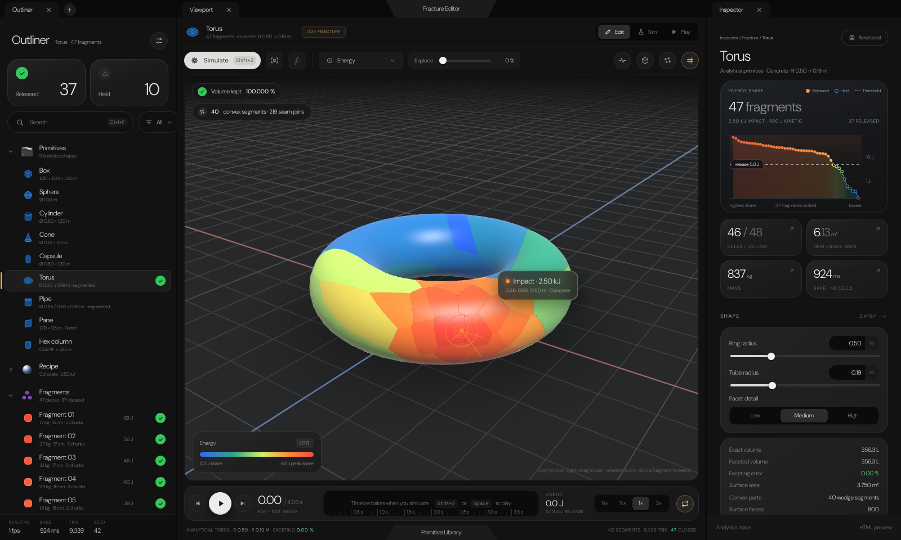
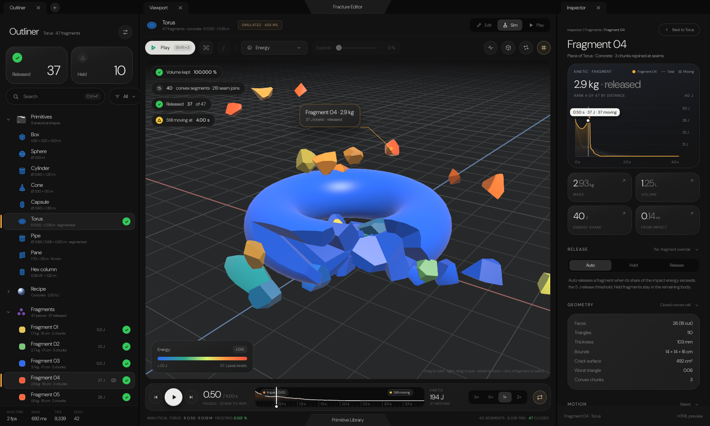
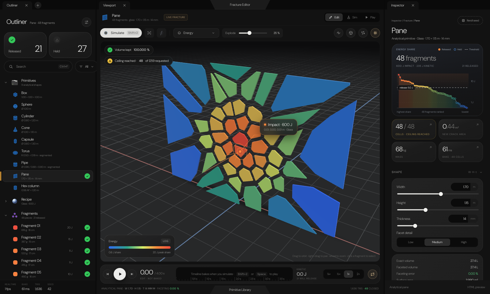
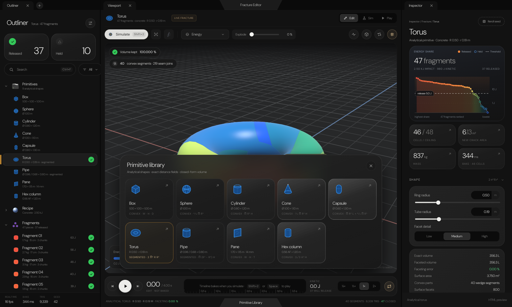
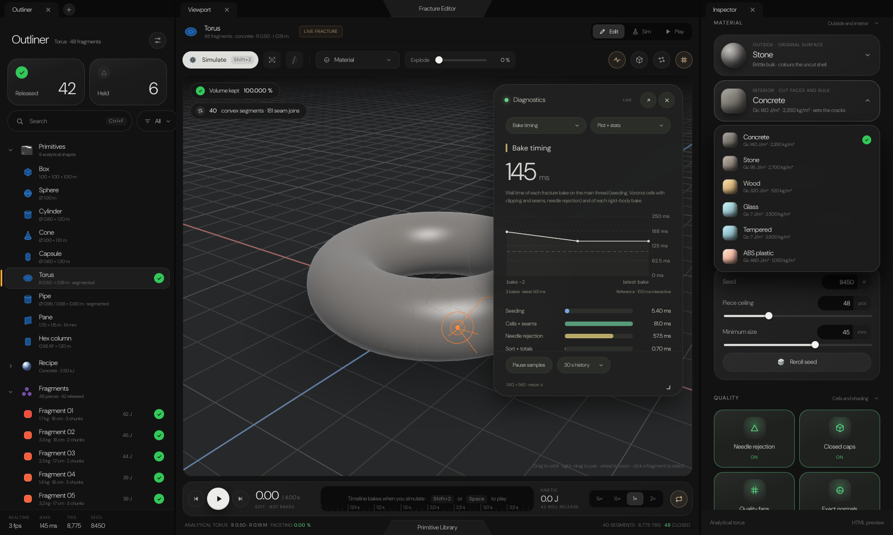

# Fracture Editor

A standalone page for fracturing **analytical primitives**, separate from Component Studio. It uses the Project Zero
editor layout: Outliner, Viewport and Inspector docks, the top and bottom notches, the segmented Edit / Sim / Play
control and quick tiles. The design follows the Frontier-OLD `SourceImages/General UI` references: glass panels, thin
oversized numerals with dimmed fractions, callouts with leader lines, warning chips, and a playback strip in the viewport footer.







## Run

```
python3 Serve.py          # http://localhost:8091/
node Tests/AnalyticFractureCheck.mjs
```

The page is pure ES modules on a raw WebGL2 renderer, with no build step. DM Sans and the Project Zero icons ship in
`Fonts/` and `Icons/`.

## Analytical primitives

Box, Sphere, Cylinder, Cone, Capsule, Torus, Pipe, Pane and Hex column. Each one is defined only by its dimensions;
everything else is derived from them (`Source/Primitives.js`):

| | Used for |
|---|---|
| **Exact signed distance** | Accepting fracture seeds, and sphere-tracing the impact so a click lands on the true surface, not on a facet |
| **Convex parts** (outward plane lists) | The solid that gets cut. Convex shapes have one part; the **torus and pipe are not convex**, so they are split into wedge segments |
| **Exact normal per surface group** | Shading. Faceted geometry looks like the real curved surface, and cut faces stay flat (*Quality → Exact normals* toggles it) |
| **Closed-form volume and area** | Compared with the faceted volume as the faceting error. Facet distances are area-preserving, so it reads 0.00 % for everything except the sphere (−0.5 %) and capsule (−0.6 %) |

Facet detail is Low / Medium / High, which sets 24 / 40 / 64 segments around and a 42 / 162 / 642-direction sphere.

## Fracture (`Source/Fracture.js`)

1. **Budget.** Impact energy buys crack area at 2·Gc per m², which sets the piece count, capped by the ceiling.
2. **Seeds.** Seeds cluster around the impact:
   - Gaussian for bulk materials.
   - Rings and spokes for glass.
   - Stretched along the grain for wood.

   A seed is kept only if it lies inside the solid.
3. **Cells.** Each Voronoi cell is a bounding box clipped by bisector planes.
4. **Pieces.** Each cell is intersected with every convex part it overlaps. On the torus and pipe, chunks of one cell
   are **rejoined across seam faces** with a union-find. Two chunks either side of seam *k* belong together exactly when
   both have a face on plane *k*, because a convex cell meets a plane in one convex region. A cell that wraps across the
   hole correctly comes back as two separate pieces.

Every face keeps its origin: *surface* (shaded with the exact normal), *cut* (the new fracture surface, drawn in the
interior colour) or *seam* (internal, never drawn). Volume is conserved to 100.0000 % on every primitive, which the
check script verifies.

The rigid-body preview (`Source/FractureSimulation.js`) is the same solver as Component Studio, copied so the page
stands alone.

## Using it

- **Outliner.**
  - Released / Held tiles; clicking one filters the list.
  - Search (Ctrl+F) and a filter: all, released, held, hidden, or rejoined at seams.
  - Three groups:
    - **Primitives**: click to switch.
    - **Recipe**: jumps to the matching inspector section.
    - **Fragments**: an energy swatch, mass, size and chunk count per fragment, an eye toggle, and a released / held
      mark. Double-click a fragment to frame it.
- **Viewport.**
  - Primary action: Simulate → Play → Restart.
  - Frame (F) and the impact tool (I: click the surface).
  - Shading: Material, Energy (blue → red), Cells or Normals.
  - Explode (Edit only), wireframe (W), seeds or launch vectors (V), grid (G).
  - Callouts follow the impact point and the selected fragment, and the chips report:
    - volume kept,
    - when the ceiling is reached,
    - seam joins,
    - how many pieces were released,
    - the settle time.
  - The bottom notch opens the **Primitive library**.
- **Inspector.**
  - Primitive view:
    - A hero chart with gridlines, axis labels, a hover probe and a tooltip:
      - **Edit:** every fragment's energy share ranked highest first, on the energy ramp. The dashed release threshold
        divides released fragments (filled dots) from held ones (rings). Click a dot to select that fragment.
      - **Sim / Play:** kinetic energy over the bake, with the playhead, the peak, the settled stretch and the moving
        count. A selected fragment's curve is drawn over the faint total. Click to scrub.
    - Stat tiles.
    - Sections: Shape (dimension sliders, facet detail, exact vs faceted volume), Material, Impact (log energy
      slider, XYZ, place on surface), Pattern (seed, ceiling, minimum size), Quality toggles, Simulation, size
      distribution and the bake log.
  - **Material** has two pickers:
    - **Outside**: the original surface. It only colours the uncut shell.
    - **Interior**: the bulk. It sets density, crack resistance (Gc) and the fracture pattern, and colours every cut
      face.
  - Fragment view: mass, volume, energy share, distance, a Hold / Release override, geometry facts and the baked motion.
- **Playback** (viewport footer).
  - To start, play / pause, step, and the clock (with a −0.6 s pre-roll in Play).
  - A scrub track showing the kinetic curve, how many pieces are moving, the settled band, and event chips (Impact, Peak,
    Settled).
  - The live kinetic readout, playback speed ¼× ½× 1× 2×, and loop.
- **Diagnostics** (toolbar pulse button or F3). A movable, resizable panel modelled on Project Zero's debug readout.
  Its position, size and choices are saved.
  - **Metrics:**
    - Frame rate and frame interval, measured from animation frames.
    - Bake timing: fracture ms split into seeding, cells + seams, needle rejection and the rest, plus the rigid-body
      bake.
    - Fracture result: pieces vs ceiling, cells, seam joins, triangles, volume kept, faceting error and worst
      triangle.
    - Simulation: kinetic energy, moving count and settle time.
  - **Controls:** Plot + stats, plot only or stats only; Pause samples; 15 / 30 / 60 s history; a hover probe on the
    plot. Esc closes it.

Keys:

| Keys | Action |
|---|---|
| Shift+1/2/3 | Edit, Sim, Play |
| Space | Play / pause |
| Home | Restart |
| `,` `.` | Step one frame |
| L | Loop |
| E | Energy shading |
| R | Reroll seed |
| `[` `]` | Previous / next fragment |
| H | Hide the selected fragment |
| Alt+F | Frame the selection |
| F3 | Diagnostics |
| Esc | Back out one step |

Edits are saved in `localStorage`.
