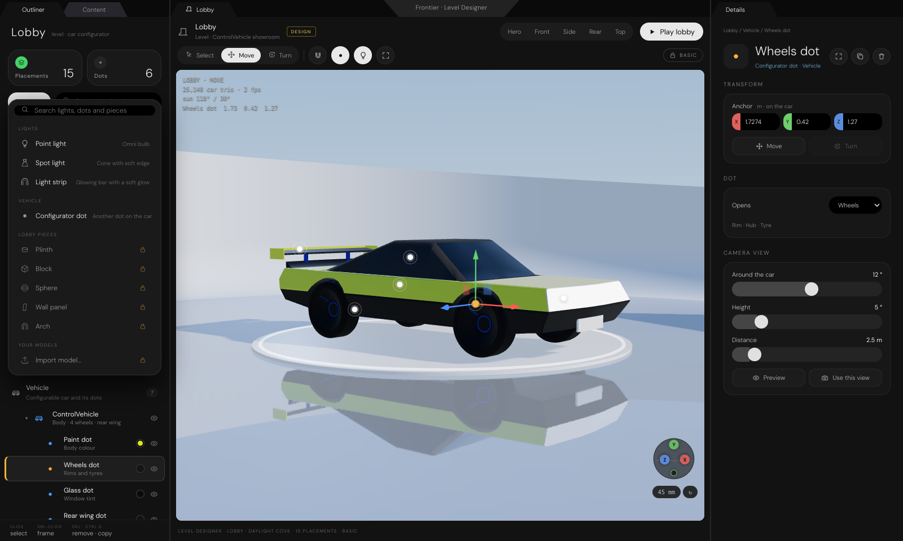
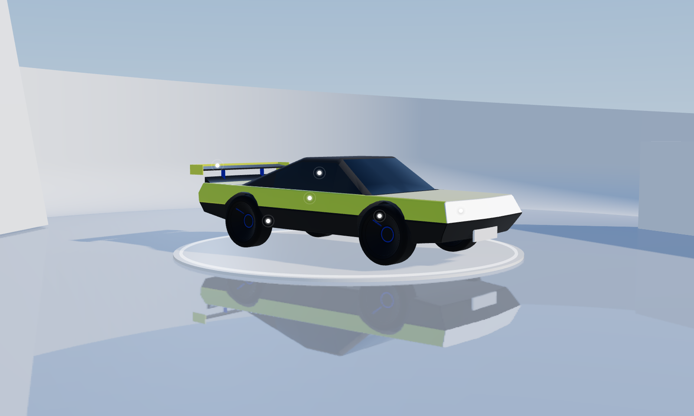
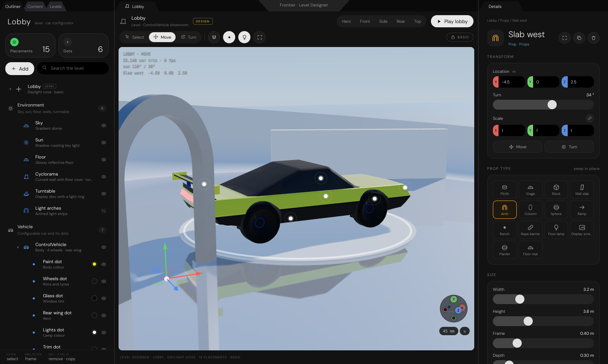
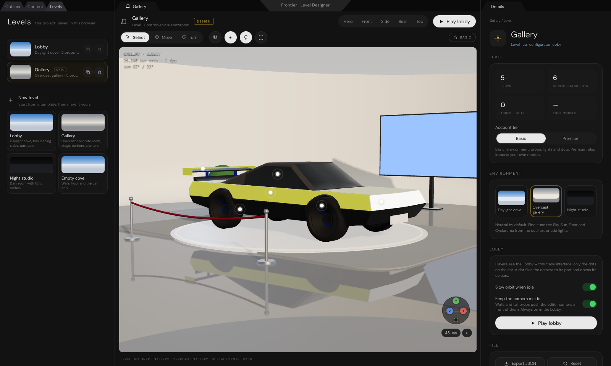

# Level Designer · Lobby

The Lobby is the first level: a car configurator showroom. Players see **no interface**, only small dots on the car. Pressing a dot flies the camera to that part (wheels, paint, glass, rear wing, lights, trim) and opens a strip of colour swatches for it.

The **Level Designer** is the editor around the level. It uses the Component Viewer's layout, styling, icons and ControlVehicle. All of that comes from `Experimental/Shared` (Studio kit, three r187, DM Sans, `.facet` models).

```
python3 Experimental/LevelDesigner/Serve.py        # http://0.0.0.0:8096/
```

| URL flag | Effect |
|---|---|
| `?play=1` | Opens straight into the Lobby, with no editor interface |
| `?tier=premium` | Starts as a Premium designer |
| `?fresh=1` | Forgets every level saved in this browser |
| `?level=<id>` | Opens a level from the browser's level library |
| `?focus=wheels` | Opens a configurator part: paint, wheels, glass, wing, lights or trim |






## Workspace
- **Outliner:** the level is split into **Environment**, **Vehicle**, **Props** and **Lights**.
  - **Environment:** sky, sun, floor, cyclorama (movable and turnable), turntable and light arches.
  - **Props:** the level's showroom pieces. Every prop can be moved, turned, scaled, resized, restyled, swapped for another type, duplicated or deleted.
  - **Vehicle:** the ControlVehicle, with its configurator dots underneath it.
  - **Lights:** any lights you have added.
  - **Your models** (imports) are Premium only.
  - Each row has an eye toggle. The **Add** menu (with search) adds lights, dots and props.
- **Content tab:** the prop catalogue (with a count of each type in the level) and model import.
- **Levels tab:** every level saved in this browser. Open, duplicate or delete a level, or start a new one from a template: **Lobby** (daylight cove, two leaning slabs), **Gallery** (overcast concrete, stage, rope barrier, planters, wall screen), **Night studio** and **Empty cove**. Opening another level saves the current one first.
- **Viewport tools:**
  - **Select** (`Q`), **Move** (`W`) and **Turn** (`E`), shown as a gizmo with axis arrows, plane handles, a free handle and a ground ring.
  - **Snap** (25 cm / 15°, or hold `Ctrl`), dots toggle (`H`), light glyphs toggle and **Frame** (`F`).
  - Hero / Front / Side / Rear / Top views and **Play lobby** (`P`, `Esc` to return).
- **Details:** each kind of placement has its own panels.
  - **Sky:** zenith, horizon and haze, plus ambient and exposure.
  - **Sun:** a draggable top-view dial, height, strength, softness and colour.
  - **Floor:** colour and gloss (how much of the room it mirrors).
  - **Cyclorama:** height, radius, sweep and top curve.
  - **Turntable:** spin, speed, radius and ring.
  - **Light arches:** count, spacing and colour.
  - **Vehicle:** every configurator row, plus the paint finish.
  - **Dots:** which part the dot opens and the camera view. **Use this view** copies the current camera.
  - **Lights:** colour, strength, reach, cone and shadows.
  - **Props:** a type grid that swaps the prop in place (keeping its position and turn), size sliders for that type, surface presets (gallery white, concrete, brushed metal, gloss black, warm wood, frosted glass), plus colour, roughness and metalness.
  - **Your models:** colour, roughness and metalness.
- **Environment presets:**
  - **Daylight cove** (default, neutral): white curved walls, blue sky and a glossy floor.
  - **Overcast gallery:** concrete floor and a warm low sun.
  - **Night studio:** dark room, arched light strips and a bright turntable ring.

## Props
15 parametric types in `Props.js`: plinth, stage, block, wall slab (with lean), arch, column, sphere, ramp, bench, rope barrier, floor lamp (with a real point light), display screen, planter and floor mat. Each type is a parameter set plus a `build()` function. Changing a size rebuilds only the geometry inside the prop, so its position, turn and scale stay the same.

## Camera
The camera can't end up behind a wall. After the rig places the camera, a ray goes from the pivot to the camera and is tested against the cyclorama and any large prop (taller than 1.6 m and wider than 1.2 m). If something is in the way, the camera moves in front of it, and it also stays above the floor. Distance you can't use doesn't pile up, so zooming in responds straight away. This is always on in the Lobby, and the level Details has a switch for the editor. It also covers dot flights and the idle orbit.

## Reflections
- **Floor:** a planar mirror (three r187 `Reflector`). The scene is rendered from a camera mirrored in the floor plane into a texture each frame, then mixed into the floor by its gloss value. Editor overlays (gizmo, light glyphs) are hidden from the mirror pass.
- **Car paint, glass and props:** image-based reflections from a PMREM environment map, baked from a copy of the sky dome, walls, floor and arches. It is re-baked when the environment changes.
- There are no screen-space reflections and no ray tracing.

## Tiers
- **Basic:** environment edits, props, added lights and configurator dots.
- **Premium:** also imported models (OBJ, glTF / GLB, STL, PLY, FCT1). Imports are centred on the floor and scaled to metres.

Levels save to a library in `localStorage` as you edit (the single-level save from the first build is migrated), and **Export JSON** writes a `Frontier.Level` v2 document (v1 files with `shapes` load as props). Imported models last for the session only.

## Files
| File | Purpose |
|---|---|
| `Main.js` | Boot and URL flags |
| `LevelDesigner.js` | Outliner, tools, Details, play mode and shortcuts |
| `Level.js` | Placements, props, templates, the level library, add/remove, picking and persistence |
| `Props.js` | Prop catalogue (parameters + builders) and surface presets |
| `Lobby.js` | Sky dome shader, cyclorama geometry, mirror floor (`Vendor/Reflector.js` from three r187), turntable, light arches and the PMREM reflection bake |
| `Vehicle.js` | ControlVehicle built straight from the facet streams, with per-part, per-family materials and paint finishes |
| `Configurator.js` | Zones, swatches, default dots, camera flights and the swatch strip |
| `Gizmo.js` | Move / turn gizmo. It listens in the capture phase, so handle drags never reach the camera rig |
| `LevelIcons.js` | Shared studio icons plus level glyphs (select, move, turn, sun, sky, floor, wall, turntable…) |
