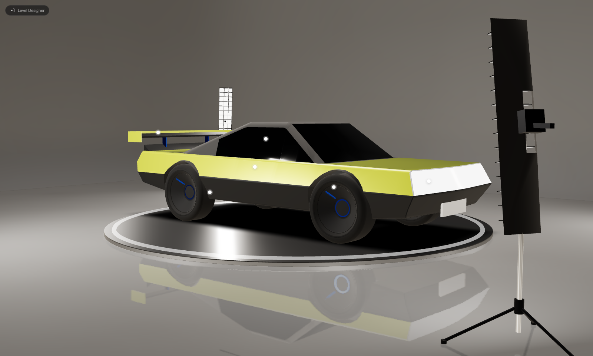
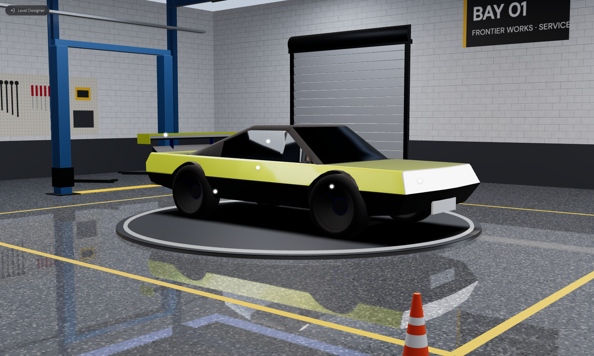
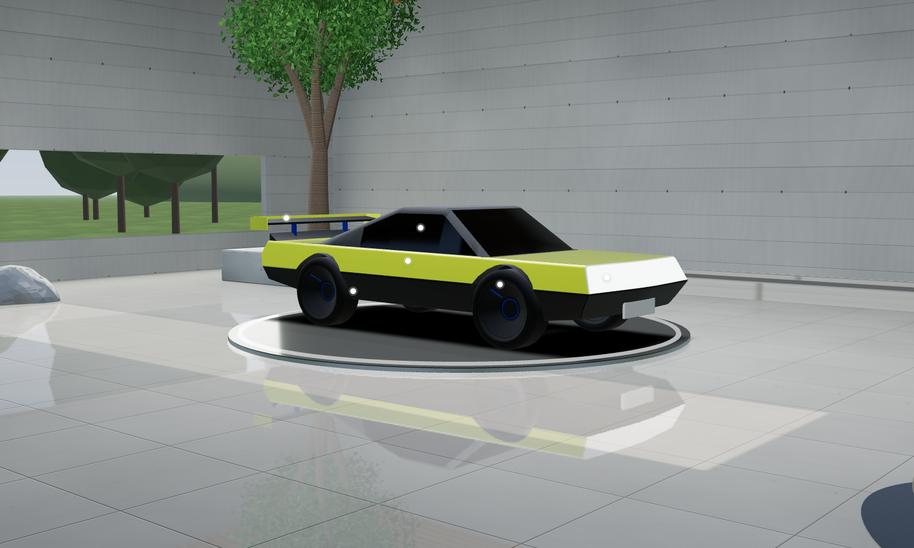
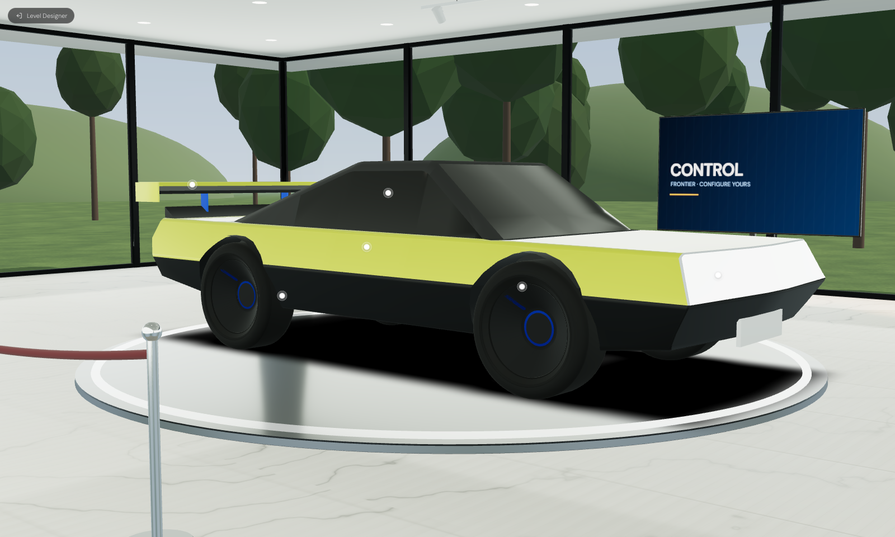
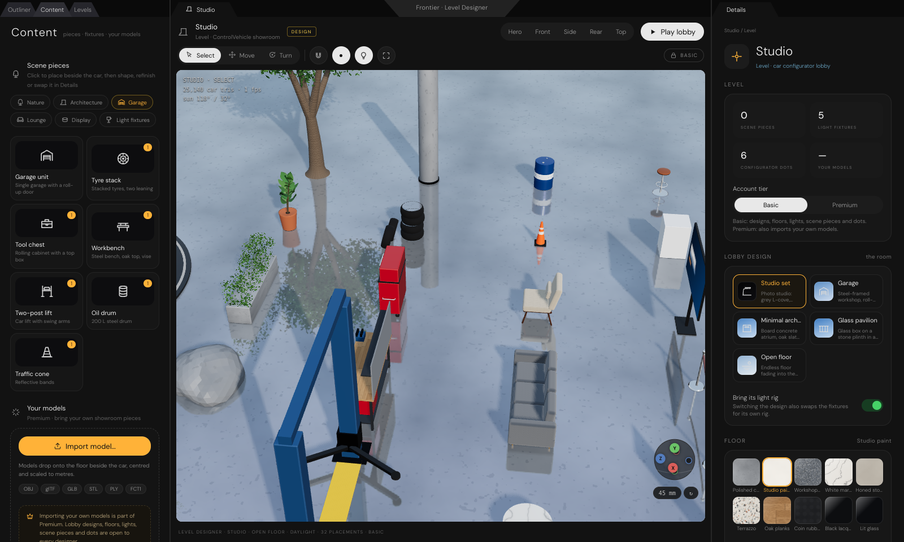
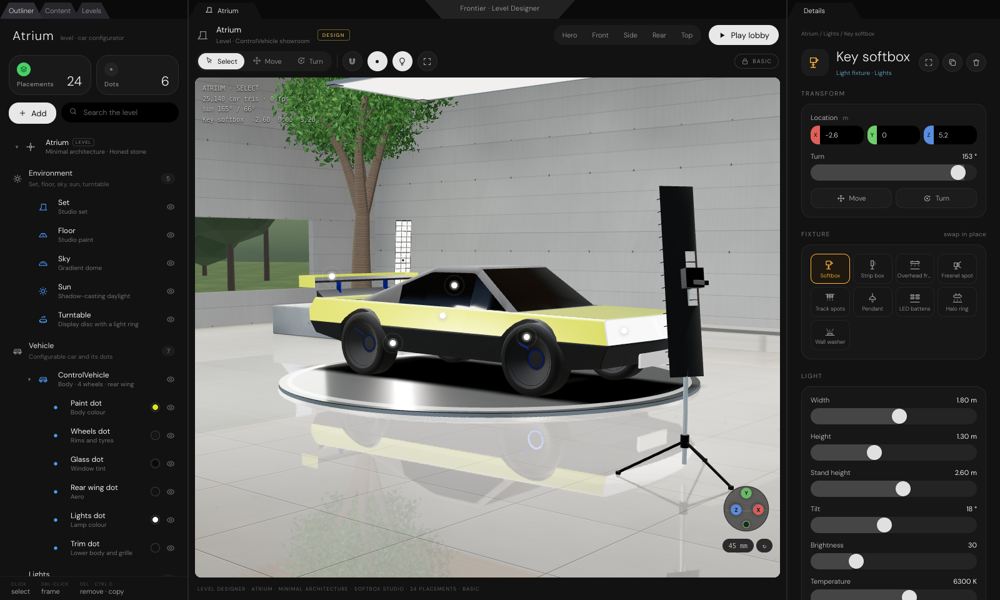
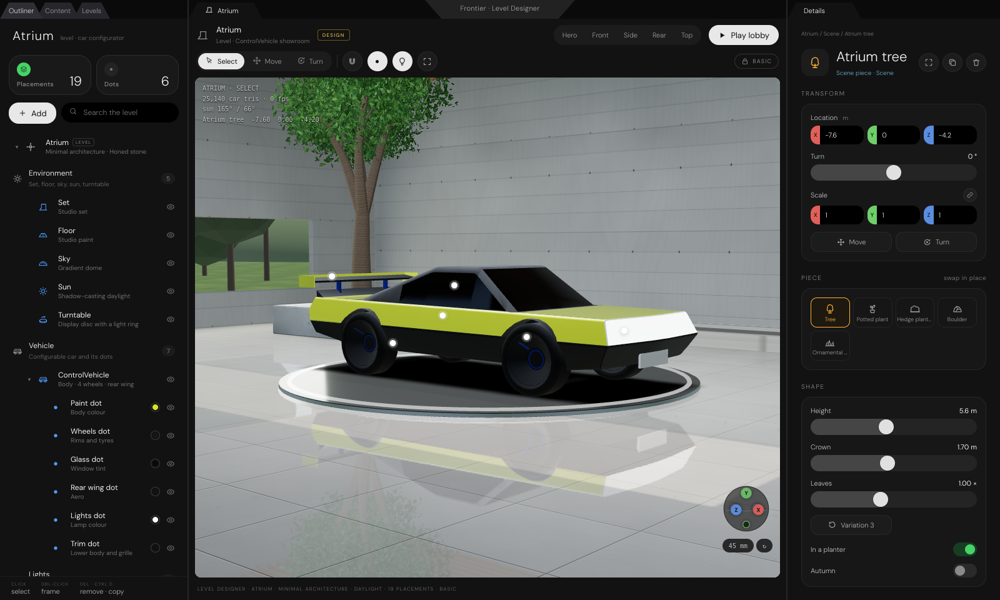
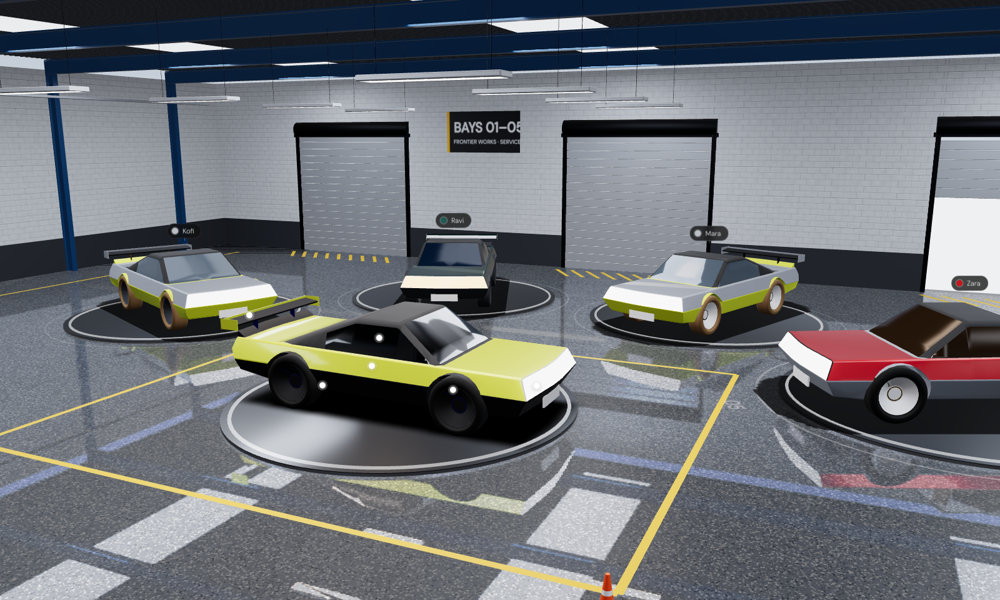
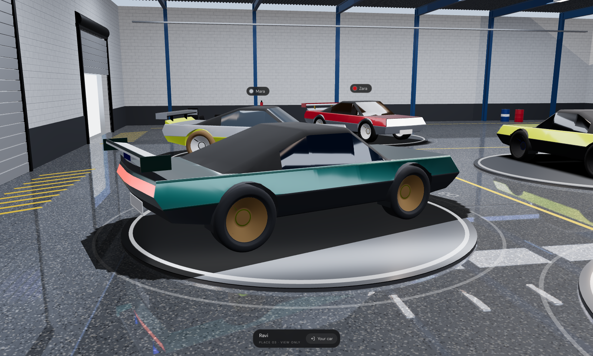
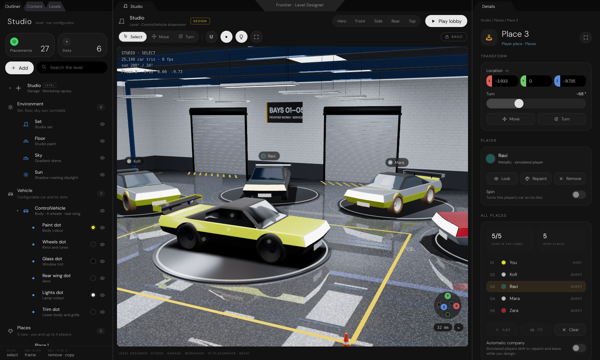

# Level Designer · Lobby

The Lobby is the first level: a car configurator showroom. Players see **no interface**, only small dots on the car. Pressing a dot flies the camera to that part (wheels, paint, glass, rear wing, lights, trim) and opens a strip of colour swatches for it.

The **Level Designer** is the editor around the level. It uses the Component Viewer's layout, styling, icons and ControlVehicle (all from `Experimental/Shared`). The lobby itself is built here: five room designs, ten floors, nine real light fixtures in seven rigs, and 28 placeable scene pieces.

```
python3 Experimental/LevelDesigner/Serve.py        # http://0.0.0.0:8096/
```

| URL flag | Effect |
|---|---|
| `?play=1` | Opens straight into the Lobby, with no editor interface |
| `?tier=premium` | Starts as a Premium designer |
| `?fresh=1` | Forgets every level saved in this browser |
| `?level=<id>` | Opens a level from the library (`studio`, `garage`, `atrium`, `pavilion` by default) |
| `?focus=wheels` | Opens a configurator part: paint, wheels, glass, wing, lights or trim |











## Places: five cars in the lobby (`Session.js`, `Places.js`)




- **Five places.** Place 01 is your own car on the centre turntable. Places 02–05 are guest discs in an arc behind it, each turned to face your car. Every guest place has its own disc and ring (sharing the turntable's materials), a painted circle and a floor number.
- **In the Lobby:** your car keeps its dots. The other cars show a name tag and no dots. Tap another car (or its tag) to fly over and look at it. This is view only: a small pill shows the player's name and a **Your car** button. Esc or tapping your own car also brings you back.
- **In the editor:** places are built-in placements under **Places** in the outliner, so you can move and turn them with the gizmo.
  - Hiding a place closes it. Its player moves to a free place, or leaves if there isn't one.
  - **Arc** sliders (distance, spread, disc radius) re-lay all four guest places.
  - Each place has **Look**, **Repaint**, **Remove** and **Spin**.
  - **Add / Fill / Clear** and **Automatic company** fill the lobby with test players.
- **Networking: none yet; players are simulated.** `LobbySession` tracks who stands where (5 max; a sixth player is turned away with `full`). It talks to a transport with two methods, `send(message)` and `onMessage(handler)`, using four JSON messages: `hello`, `config`, `bye`, `full`. `SimulatedTransport` stands in for the server. A WebSocket or WebRTC transport on your backend only has to implement the same two methods. A car's paint travels as `configOf(vehicle)` (finish and the colour of each part).
- Guest cars are `vehicle.shell()` copies: shared geometry, own materials, about 25k triangles each.
- URL flags: `?guests=0..4` sets how many simulated players are already in the lobby (default 3). `?company=1` keeps players coming, repainting and leaving.

## Lobby designs (`Sets.js`)
All roofed rooms were enlarged for five cars: **Studio** cove 38 × 30.5 m, 8.4 m high; **Garage** 40 × 34 × 7.4 m with three roll-up doors and three skylights; **Minimal architecture** 38 × 34 × 8 m; **Glass pavilion** 36 × 30 × 4.8 m. Template pieces sit clear of the arc.

Each design is a complete room at real scale, with its own sky, sun, ambience, recommended floor and recommended light rig.

| Design | What it is |
|---|---|
| **Studio set** | Photo studio: a grey L-shaped cove (curved floor-to-wall sweep), a pipe lighting grid, black velvet drapes |
| **Garage** | Steel portal-framed workshop: block walls with a painted dado, roll-up doors, corrugated roof with skylights, a pegboard, painted bay lines on epoxy |
| **Minimal architecture** | Board-formed concrete atrium: oak slat ceiling broken by a skylight, a long low window slot, a niche and a reflecting pool |
| **Glass pavilion** | Frameless glass box with slim black steel on a stone plinth with steps, floating white roof, garden and trees outside |
| **Open floor** | Floor that fades into the sky at the horizon |

Roofed rooms carry **sky fill**: soft area lights under skylights and behind glazing, so daylight reaches the car the way it would through real openings. Glass never casts shadows.

## Floors
Polished concrete, studio paint, workshop epoxy, white marble, honed stone, terrazzo, oak planks, coin rubber, black lacquer and lit glass. All of them are procedural textures (`Textures.js`), not image files. Each one sits on a planar mirror, and **Gloss** sets how much of the room it reflects. **Pattern scale** and **Tint** adjust the texture.

## Lighting (`Fixtures.js`)
Fixtures are modelled hardware that carries real lights, not glowing strips:

| Fixture | Light |
|---|---|
| Softbox | Area light in a box head with a diffuser (and optional egg-crate grid) on a C-stand |
| Strip box | Tall narrow area light for rims |
| Overhead frame | Large diffusion frame hung over the car |
| Fresnel spot | Shadow-casting spot with a lens, barn doors and an optional haze beam |
| Track spots | Ceiling track with 1–6 gallery heads |
| Pendant | Dome shade on a cord with a warm point light |
| LED battens | Row of ceiling panels (area lights) |
| Halo ring | Hung ring with a soft downlight |
| Wall washer | Floor uplight grazing a wall or the car |

Every fixture has brightness, colour temperature (Kelvin), a gel colour and its own size, height and tilt. **Aim at car** turns it towards the vehicle.

**Rigs** replace every fixture at once, aimed at the car:
- **Softbox studio:** key softbox, fill strip, two rim strips and an overhead.
- **Overhead light:** one long frame plus floor kickers.
- **Spot drama:** fresnel key and rims with haze, plus a floor washer.
- **Daylight:** sun and sky only.
- **Workshop:** two rows of battens.
- **Gallery tracks:** track spots from both sides, plus daylight.
- **Halo:** light ring and two washers.

Area lights (three `RectAreaLight`) give the long soft reflections you see in car photography. Spot lights add the shadows. The **hardware** toggle hides stands and housings without turning the lights off.

## Scene pieces (`Items.js`)
| Category | Pieces |
|---|---|
| Nature | Tree, potted plant, hedge planter, boulder, ornamental grass |
| Architecture | Feature wall, glass wall, column, floating stairs, platform, portal frame, garage unit |
| Garage | Tyre stack, tool chest, workbench, two-post lift, oil drum, traffic cone |
| Lounge | Lounge chair, sofa, coffee table, reception desk, bar stool, rug |
| Display | Plinth, display screen, rope barrier, roll-up banner |

Each piece has its own shape parameters, such as height, crown, seed, count, width or label. It can use one of 28 finishes, including concrete, oak, walnut, marble, brushed steel, chrome, brass, enamel, fabric, leather, glass and frosted glass, or a custom colour. You can also swap a piece for another of its category in place.

## Templates (Levels tab)
- **Studio:** grey cove with the softbox rig.
- **Night stage:** lacquer floor, glowing platform, fresnel spots and haze.
- **Garage:** workshop with a lift, tool chest, tyres and battens.
- **Minimal architecture:** concrete atrium, skylight, tree and a lounge corner.
- **Glass pavilion:** marble floor, gallery tracks, a reception desk and plants.
- **Open floor:** concrete to the horizon, in daylight.

## Workspace
- **Outliner:** Environment (set, floor, sky, sun, turntable), Vehicle (with its dots), Lights (fixtures), Pieces and Your models (Premium). Each row has an eye toggle.
- **Content tab:** a piece and fixture browser by category, with an in-level count. Click a card to place it next to the car.
- **Details:**
  - **Level:** design, floor and rig pickers.
  - **Set:** contact shadow strength and softness.
  - **Floor:** finish, gloss, scale and tint.
  - **Sky / Sun.**
  - **Turntable:** spin, radius, ring glow and disc finish.
  - **Fixtures and pieces:** each has its own panel.
  - **Dots:** zone and camera view.
- **Viewport:** Select (`Q`), Move (`W`), Turn (`E`), snap, dots (`H`), hardware toggle, Frame (`F`), Hero / Front / Side / Rear / Top and **Play lobby** (`P`, `Esc`).

## Rendering notes
- **Floor reflections:** a planar mirror (three r187 `Reflector`) under a textured coat. The coat's opacity follows the floor gloss.
- **Contact shadow:** an orthographic depth pass of the car, blurred, under the car. It only redraws when the car moves.
- **Paint and glass:** PMREM environment map baked from inside the room (sky, set, floor, fixtures). It is re-baked when the design, floor or rig changes.
- There are no screen-space reflections and no ray tracing.
- The camera never ends up behind a wall or a large piece: the spring arm described in round 2.

## Tiers and saving
- **Basic:** designs, floors, rigs, fixtures, pieces and dots.
- **Premium:** also imported models (OBJ, glTF / GLB, STL, PLY, FCT1), for the session only.
- Levels save to a `localStorage` library as you edit.
- **Export JSON** writes a `Frontier.Level` v4 document (v4 adds the places and arc). v3 saves still open, with the default arc; older saves fall back to their template.

## Files
| File | Purpose |
|---|---|
| `Main.js` | Boot and URL flags |
| `LevelDesigner.js` | Outliner, Content browser, Details panels, tools, play mode and shortcuts |
| `Level.js` | Placements, fixtures and pieces, rigs, templates, library, picking and persistence |
| `Lobby.js` | Sky dome, the active design, mirror floor, contact shadow, turntable and the PMREM bake |
| `Sets.js` | The five lobby designs and ten floors |
| `Fixtures.js` | Light fixtures and rigs |
| `Items.js` | Scene piece catalogue |
| `Kit.js` | Finishes (materials) and geometry helpers shared by sets, fixtures and pieces |
| `Textures.js` | Procedural surface textures and swatches |
| `Vehicle.js`, `Configurator.js` | ControlVehicle (plus `shell()` copies for guests) and the dot configurator (`configOf` / `applyConfig`) |
| `Session.js` | Lobby session (5 places, join / repaint / leave) and the simulated transport |
| `Places.js` | Guest place discs, the arc layout and parked-car shadows |
| `Gizmo.js` | Move / turn gizmo |
| `LevelIcons.js` | Shared studio icons plus level, piece and fixture glyphs |
| `Vendor/` | three r187 addons: Reflector, RectAreaLight libs, RoundedBoxGeometry, BufferGeometryUtils |
