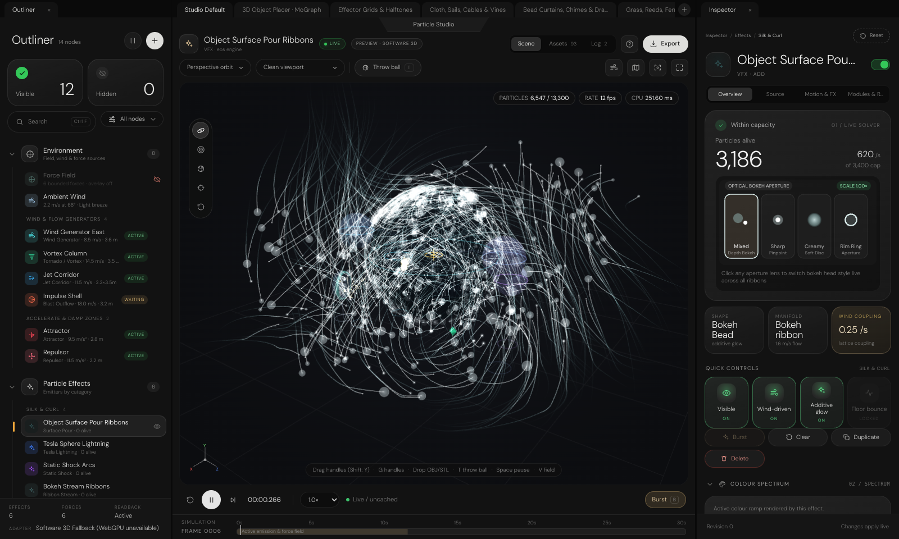
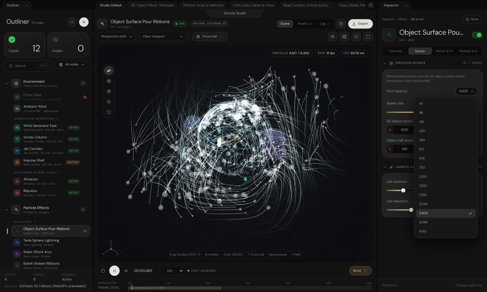
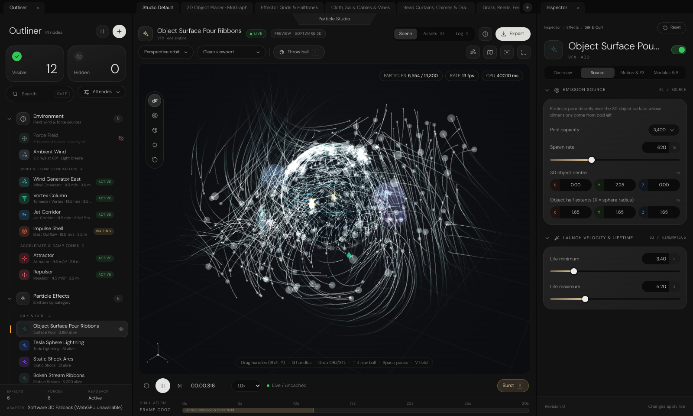
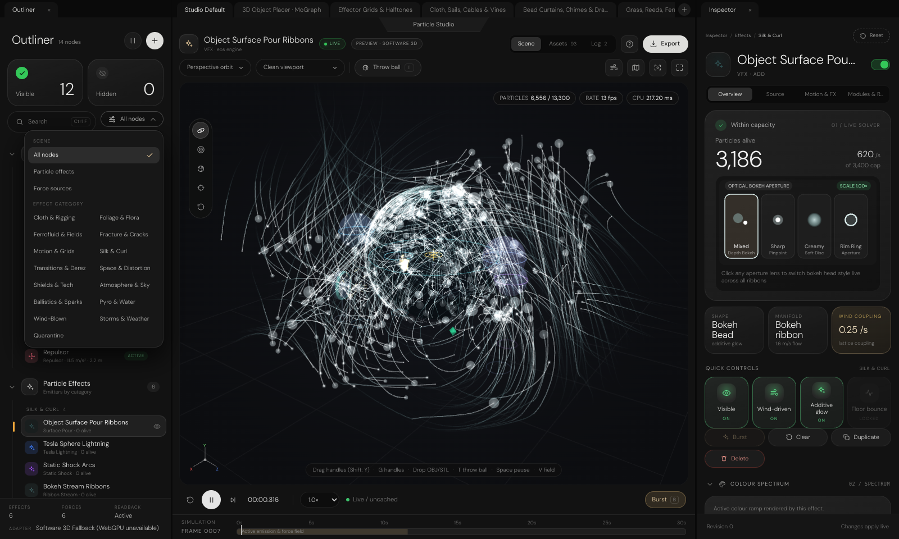

# Particle Studio (rewritten UI components)

A duplicate copy of `Experimental/ParticleEditor Final` (from `unassignedinbox/Frontier`, branch `arena/6eeea758-frontier`).
The **header, outliner, inspector (frame, tabs and every control) and footer are rewritten from scratch** as new
components in `UI/`, following the Project Zero editor rules shared with the Fracture Editor and UV editor (General UI
references from `Frontier-OLD/SourceImages/General UI`). The particle engine, viewport canvas, transport and timeline are
unchanged.

```
python3 Serve.py 8097        # serves this folder with no-store headers → http://localhost:8097/
node Engine/CheckForceFields.mjs
```



## Components (`UI/`)

| File | What it is |
| --- | --- |
| `Shell.js` | Mounts the components into the empty hosts in `index.html` (`data-ui="outliner" / "header" / "inspector"`). `ParticleEditor.js` imports it first, so every element id exists before the editor runs. |
| `Header.js` | Centre dock header: scene documents as dock tabs (+ new), the "Particle Studio" notch, a viewport heading (seat, title, subtitle), LIVE and engine badges, **Scene / Assets / Log** segments, help, Export, and a tools row (camera, overlay, throw ball, arrows, minimap, focus, maximise). `SetScenes(list, active, onPick)`. |
| `Outliner.js` | Outliner dock: dock tab, thin h1 and scope line, compact and add buttons, glass Visible/Hidden tiles, search with `Ctrl F`, **one filter pick** (Scene + 15 effect categories), a collapsible tree of groups (chevron, icon seat, title/subtitle, count) with sub-heads and node rows (seat tinted with the node colour, name/meta, state pill, eye on hover, amber selection bar), and a host for the status strip. The editor passes data only: `Render(groups)`, `SetFilters()`, `OnSelect`, `OnFilter`. |
| `Inspector.js` | Inspector dock frame: crumbs `Inspector / Group / **Leaf**` with Reset, heading (glowing symbol seat, 23 px editable name with Enter/Esc, type line, enable toggle), segmented page tabs, the page scroller and the foot (revision). `SetHeading({...})`, `SetTabs(defs, active, onPick)`. |
| `StatusBar.js` | The studio's only footer, at the outliner foot: Effects, Forces, Readback, Adapter. |
| `Controls.js` | The inspector control kit (see below). |
| `Runtime.js`, `Glyphs.js`, `Dom.js` | Refresh runtime (Register / Broadcast / scopes, moved out of `StudioControls.js`), the glyph library, and a small `h()` element factory. |
| `Studio.css` | All styling for the above. |

### Inspector control kit (`UI/Controls.js`)

Every control is new DOM and new CSS. The editor still calls the old names through `StudioControls.js`, which now only
re-exports the kit, so the 7,000 lines of inspector logic and every binding are untouched.

| Old name (editor calls) | New component |
| --- | --- |
| `SectionCard` | `Section`: uppercase head with chevron, glyph and tag; one gradient panel. Collapse state is remembered across page rebuilds. |
| `SliderRow` | `Slider`: label (drag to scrub; Shift fine, Alt coarse), black amount field with unit, and a custom full-width drag track (pointer drag, arrow keys, Home/End). |
| `SelectRow` | `Select`: a pick face that opens a **floating menu on `<body>`**, so the inspector scroller never clips it. It flips upward near the bottom, supports arrow keys and Esc, and ticks the current value. |
| `SwitchRow` | `Switch`: label + detail with a compact toggle. |
| `SegmentedRow`, `PillTabs` | `Segmented`, `Tabs`: segmented track. |
| `VectorRow` | `Vector`: colour-tagged X/Y/Z fields; drag an axis tag to scrub it. |
| `ColourRow` | `Colour`: swatch over the native picker, editable hex, and an alpha drag track on a checkerboard. |
| `ToggleTile` (+ `TileGrid`) | `Tile`: glass quick tile with a lit seat and On/Off/Locked state. |
| `ActionRow` | `Actions`: wide buttons that wrap; accent and danger tones. |
| `ChipToggles` | `Chips`. |
| `MetricTrio` | `Stats`: glass stat tiles with large thin numbers; highlight → warm tile. |



## What was removed

- The old header, outliner, inspector heading/tabs, footer and control implementations, and their CSS:
  `ParticleEditor.css` went from 2,093 to about 1,200 lines. None of the old component classes (`tree-row`, `document-tab`,
  `property-group`, `property-switch`, `kpi-card`, `value-pill`, `status-bar`, …) are referenced anywhere any more.
- Duplicates: three footers became one status strip. The engine status is a single badge. The Log drawer button and the
  Field overlay button are hidden: the Log segment and the overlay pick own those actions, and the **V** key still works.
  The 18 filter chips became one pick. The in-viewport caption repeated the header and has been removed.

## Not rewritten (bespoke page content)

The large one-off instruments that individual inspector pages draw themselves are still the editor's own DOM. They now
sit inside the new sections and panels: the effect hero readout and aperture picker, the force-source dial, the
ForceFieldVisualization preview, the formula editor, and the colour ramp editor.



