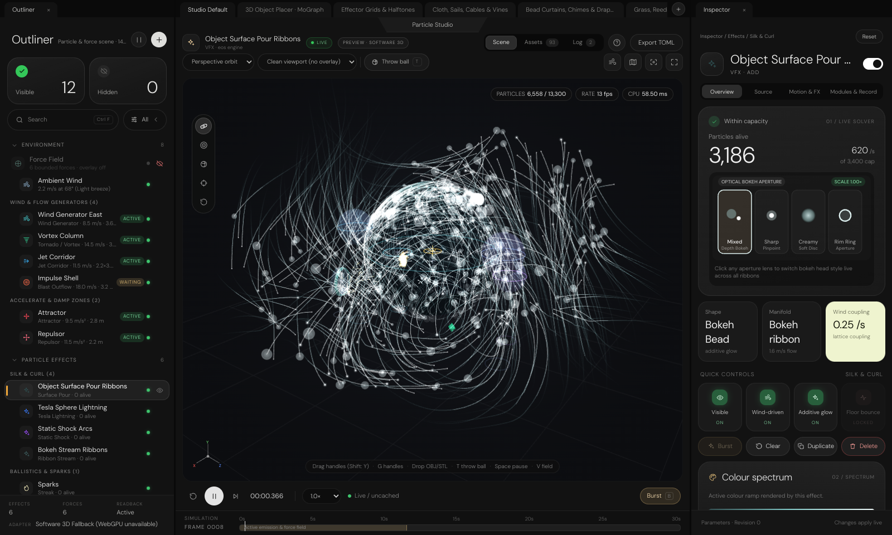
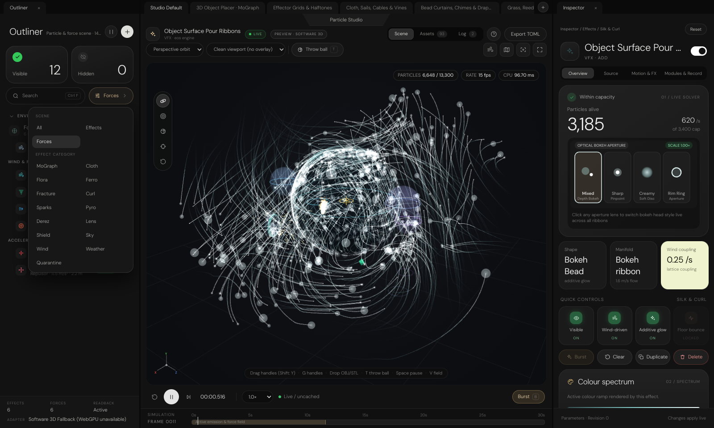

# Particle Studio (redesigned shell)

A duplicate copy of `Experimental/ParticleEditor Final` (from `unassignedinbox/Frontier`, branch `arena/6eeea758-frontier`) with
the **header, outliner, inspector heading/tabs and footer** rebuilt in the Project Zero editor shell, following the same rules
as the Fracture Editor and UV editor (General UI references from `Frontier-OLD/SourceImages/General UI`). The particle
engine, viewport, transport, timeline, inspector page content, add menu, asset library and dialogs are unchanged.

```
python3 Serve.py 8097        # serves this folder with no-store headers → http://localhost:8097/
node Engine/CheckForceFields.mjs
```



## What changed

| Area | Before | After |
| --- | --- | --- |
| Header | 56 px global bar: brand, slanted scene tabs, Workspace/Assets/Log nav, engine pill, help, export | No global bar. Three docks start at y = 0, each with its own dock tab. Scene documents are dock tabs on the centre dock with a `+`, a "Particle Studio" notch below them, and a viewport header holding the identity, LIVE + engine badges, a **Scene / Assets / Log** segmented control, help and Export TOML |
| Outliner | Heading, stat tiles, search, **18 always-visible filter chips**, tree, footer label | `h1` heading + scope line, compact and add round buttons, glass Visible/Hidden tiles with large thin numbers, search with `Ctrl F` hint, and **one filter dropdown** (Scene: All/Effects/Forces, then 15 effect categories). The face shows the active filter and turns amber when filtered |
| Inspector | Crumb row, framed heading block, pill tabs, footer revision | Crumb + Reset, open heading (glass symbol, 22 px editable name, type line, compact enable switch), `seg` tabs (10 px, `#0b0b0b` track, `#2c2c2c` active), and an `ins-foot` with the revision |
| Footer | **Three footers**: outliner label, inspector revision, global status bar (ready text, effects, readback, GPU dot, adapter) | **One status strip** at the outliner foot: Effects, Forces, Readback and Adapter. The inspector keeps only its revision foot |

### Duplicates removed

- **Engine status** was shown in four places (header pill, status-bar ready text, GPU dot, left footer label). It is now one badge in the viewport header. The long description is the badge's accessible description and tooltip (`#status-ready` lives inside the badge as screen-reader text).
- **Footers**: three became one status strip plus the inspector revision foot.
- **Log Stream**: the `Log` segment and the drawer round button did the same thing. The round button is hidden and the segment stays.
- **Field overlay**: the `Field · V` pill and the overlay select both toggled the overlay. The select stays (it includes "Clean viewport"). The pill is hidden, but the **V** key still works and keeps the select in sync.
- **Filter chips**: 18 chips became one dropdown. The same `#scene-filters button[data-filter]` buttons are reused, so the filter logic is unchanged.
- **Viewport caption**: the in-canvas object/LIVE caption repeated the viewport header and has been removed. Its IDs moved to the header.

## Contract kept

Every element ID that `ParticleEditor.js` reads is still present. Only `left-footer-label` and `gpu-dot` were removed, and no
script read them. New: `status-forces`, `scene-filter-drop/face/label/glyph/chev`, `inspector-hint`.

JS edits in `ParticleEditor.js` (small):
- `status-effects` and `status-forces` are separate numbers.
- The readback reads `NN KB · N.N ms`.
- `status-ready` is plain text.
- `ConstructFilterDrop()` / `SyncFilterFace()` drive the dropdown (it closes on outside click and Esc).

All new styling is in `Shell.css`, scoped to `.pz-docks` and loaded after `ParticleEditor.css`. Asset URLs are versioned (`?v=`).


