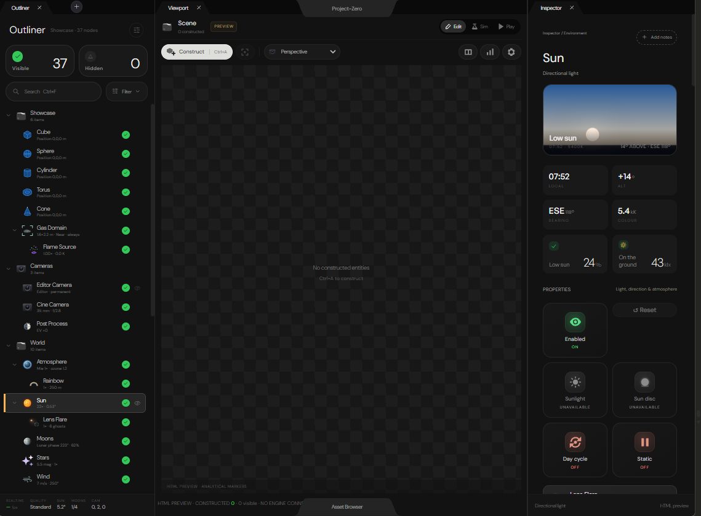

# 🧩 Project-Zero Editor UI (`Experimental/ProjectZeroEditor`)

> **TL;DR**: Canonical HTML/JS reference specification for the native C++20 shared UI components (`Engine/Components/` + `Engine/Workspaces/` + `Engine/Editor/`). Defines the trapezoidal dockable tab bars (`Outliner`, `Viewport`, `Inspector` + adjacent `+` tab button), top `Project-Zero` trapezoidal Notch, bottom `Asset Browser` trapezoidal drawer tab, Outliner entity cards, and shared Environment/Light/Material/Fog/Wind inspector cards.



---

## 🏷️ Key UI Surfaces & Shared Component Targets

| Surface in `ProjectZeroEditor` | Visual & Interactive Mechanics | Target Shared C++20 Unit |
| :--- | :--- | :--- |
| **Trapezoidal Dock Tabs** (`Outliner ×`, `Viewport ×`, `Inspector ×`, `+`) | Sloped side bevels, active bottom join into panel background, circular `×` close button, adjacent circular `+` button; dockable across any application window, tears off into an OS window when undocked, and restricts docking strictly within the application. | `Engine/Components/Docking/{TrapezoidalTabGeometry,DockingPanel}.{h,cpp}` |
| **Top Trapezoidal Notch & Bottom Drawer Tab** | Top-center pull-down `Project-Zero` Control Centre notch and bottom-center pull-up `Asset Browser` drawer handle. | `Engine/Components/Overlays/` & `Engine/Editor/Explorer/ContentBrowser` |
| **Scene Outliner** | `Visible` / `Hidden` summary counters, search/filter pills, collapsible collection hierarchy (`Showcase`, `Cameras`, `World`), per-classification SVG icons, and status toggles. | `Engine/Editor/Explorer/SceneOutliner.{h,cpp}` |
| **Property Inspector** | Hero preview banner (`Low sun` sky gradient), 2×2 metric readout cards (`07:52`, `+14°`, `ESE 118°`, `5.4 kK`), status tiles (`Enabled`, `Day cycle`), and shared scalar/color controls. | `Engine/Components/PropertyPanels/` & `Engine/Components/Controls/` |

---

## 🔍 Local Preview

```bash
python3 Experimental/ProjectZeroEditor/Serve.py 8092
```
